# Augustus - Iris 메뉴얼

[English](MANUAL.md) · **한국어** · [README](README.md)

## 차례
1. 설치와 첫 실행
2. 멀리 있는 친구와 함께하기 (인터넷)
3. 방 만들기 (방장)
4. 방 입장 (참가자)
5. 대기실과 방 옵션
6. 게임 중
7. 저장과 이어하기
8. 게임 방식별 규칙
9. 시나리오 제작기
10. 자주 묻는 것

---

## 1. 설치와 첫 실행

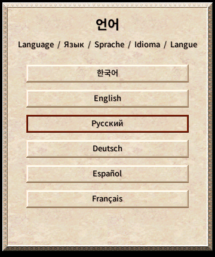
*처음 실행할 때 화면 언어 고르기*

1. [Releases](https://github.com/the-akansas/augustus-iris/releases/latest)에서 `Augustus-MP-<버전>-global.zip`을 받습니다.
2. 원하는 폴더에 **끝까지** 압축을 풉니다. 압축 파일 안에서 바로 실행하면 설정을 저장하지 못합니다.
3. `Play.cmd`를 실행합니다.
4. **화면 언어**를 고릅니다. English, 한국어, Русский, Deutsch, Español, Français 중에서 고르고, 나중에 옵션에서 바꿀 수 있습니다.
5. **시저 3 폴더**를 고릅니다. `c3.sg2`가 있는 폴더입니다. 한 번 고르면 기억합니다.

시작하면 Augustus 메인 메뉴가 나옵니다. 이 프로젝트가 더한 단추는 두 개입니다.

- **멀티플레이**: 방을 만들거나 다른 사람의 방에 들어갑니다 (3장, 4장).
- **멀티 시나리오 제작기**: 멀티플레이 시나리오를 만들고 고칩니다 (9장).

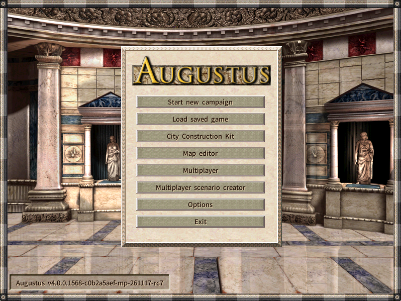
*메인 메뉴: 이 프로젝트가 더한 단추는 멀티플레이와 멀티 시나리오 제작기*

나머지 단추(새 캠페인, 저장 불러오기, 도시 건설 키트, 지도 편집기, 옵션)는 원래 Augustus 그대로이고, 혼자 하는 시저 3도 그대로 즐길 수 있습니다.

처음 실행할 때 깃발 천과 교역소 지붕 그림을 내 시저 3 그림으로 만듭니다. 원본 설치 폴더는 읽기만 하고, 게임은 프로그램 폴더 안의 개인 사본으로 돌아갑니다.

도시 이름, 건물 이름, 고문관 글처럼 **시저 3 자체의 글은 내가 가진 시저 3의 언어**로 나옵니다. 영어판 시저 3이면 영어, 독일어판이면 독일어입니다. 이 프로젝트에서 추가한 화면(방, 거래, 채팅, 제작기)은 내가 고른 화면 언어로 나옵니다. (언어 목록의 순서는 문의가 많은 언어부터 앞으로 오도록 계속 바꾸겠습니다. 언어끼리 자리 경쟁인 셈입니다. 다만 맨 위는 한국어 자리입니다.)

**새 버전으로 올릴 때만** `Import-previous-settings.cmd`를 씁니다. 처음 설치할 때는 필요 없습니다. 실행해서 예전 버전 폴더를 고르면 게임 설정, 단축키, 시저 3 폴더 위치, 최근 IP와 아이디, 내 시나리오를 새 폴더로 가져옵니다. 공동 저장은 가져오지 않습니다.

## 2. 멀리 있는 친구와 함께하기 (인터넷)

같은 집이나 사무실처럼 같은 공유기에 연결되어 있다면 이 장은 건너뛰어도 됩니다.

이 판에는 공개 서버나 계정이 없습니다. 방은 방장 PC의 TCP 포트 하나(48921)이고, 참가자는 IP로 들어갑니다. 같은 집이나 같은 공유기가 아닌 사람과 하려면 둘 중 하나를 합니다.

- **가상 랜** (쉬움): 모두 같은 가상 랜(Radmin VPN, Tailscale, ZeroTier 등)에 들어갑니다. 방장은 방 만들기의 "사용할 네트워크"에서 그 가상 랜 주소를 고르고, 참가자는 그 주소로 들어옵니다.
- **포트 열기**: 방장 공유기에서 TCP 48921을 방장 PC로 열어 주고, 참가자는 방장의 공인 IP로 들어옵니다.

자세한 방법은 배포 파일의 `Internet-play.txt`에 있습니다.

## 3. 방 만들기 (방장)

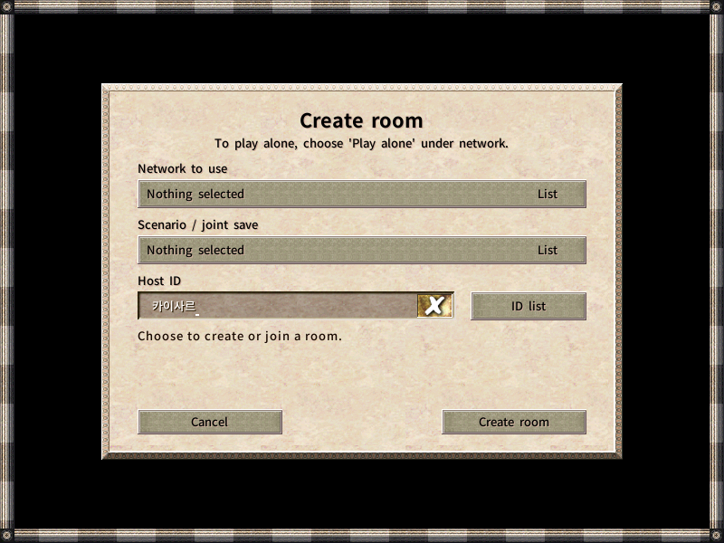
*방 만들기 창*

1. 메인 메뉴에서 **멀티플레이**, **랜 플레이**, **방 만들기**를 누릅니다.
2. **사용할 네트워크**: 다른 사람이 들어올 네트워크를 고릅니다.
    - **같은 집이나 사무실**처럼 같은 공유기(라우터)에 연결된 친구와 할 때는, 그 공유기의 네트워크(보통 이더넷이나 Wi-Fi)를 고릅니다.
    - **멀리 있는 친구**와 할 때는 가상 랜 프로그램을 씁니다. Radmin VPN, ZeroTier, Tailscale 같은 무료 프로그램에 모두 함께 들어가면, 서로 다른 곳에 있어도 같은 공유기에 연결된 것처럼 이어집니다. 이때는 그 프로그램의 네트워크를 고릅니다. 자세한 방법은 2장에 있습니다.
    - **혼자 시험**할 때는 **혼자 플레이 (이 PC 전용)**를 고릅니다.
3. **시나리오 / 공동 저장**: 기본 시나리오, 내가 만든 시나리오, 또는 이어할 공동 저장을 고릅니다. 항목을 누르면 지도와 설명이 보입니다.
4. **아이디**를 정하고 **방 만들기**를 누릅니다. 방에 내 IP가 표시됩니다. 이 주소를 참가자에게 알려 줍니다.

## 4. 방 입장 (참가자)

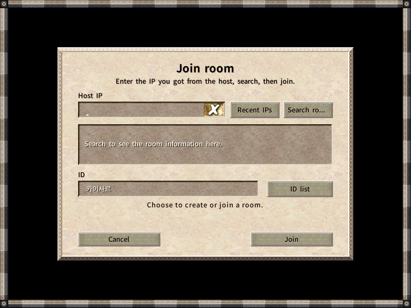
*방 입장 창*

1. 메인 메뉴에서 **멀티플레이**, **랜 플레이**, **방 입장**을 누릅니다.
2. **방 찾기**로 같은 네트워크의 방을 찾거나, 방장 IP를 입력합니다. **최근 IP**에서 예전 주소를 고를 수도 있습니다.
3. 들어갈 수 없는 방은 이유(가득 참, 이미 시작함, 버전이 다름 등)가 나옵니다.
4. 아이디를 정하고 **입장**합니다.

방의 모든 사람이 **같은 버전**을 써야 합니다. 버전은 메인 메뉴와 대기실에 나옵니다.

## 5. 대기실과 방 옵션

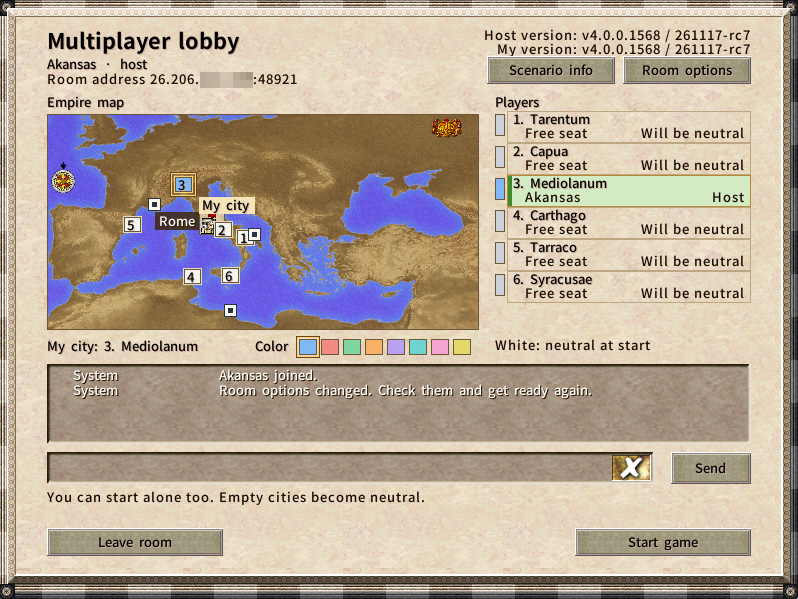
*대기실: 도시 자리, 플레이어, 색 고르기, 채팅*

- 시나리오의 제국 지도에 도시 자리가 보입니다. 자리에 마우스를 올리면 그 도시의 지형 미리보기가 나옵니다.
- 원하는 **도시 자리**와 **색**을 고르고 **준비**를 누릅니다.
- **색은 신중히 고르세요.** 고른 색은 게임 내내 "나"를 나타냅니다.
    - 다른 플레이어의 제국 지도에서 내 도시의 깃발이 이 색으로 보입니다.
    - 다른 플레이어가 나와 거래하려고 짓는 교역소의 지붕이 이 색입니다. 도시 안에 교역소가 여러 개 있어도 지붕 색만 보면 누구와 거래하는 곳인지 알 수 있습니다.
    - 채팅의 이름 표시, 플레이어 탭, 군단 깃발도 같은 색입니다.
    - 그래서 서로 헷갈리지 않게, 눈에 잘 띄는 색을 고르는 것이 좋습니다. 색은 8가지입니다.
- 대기실 채팅으로 이야기합니다.
- 모두 준비되면 방장이 시작합니다. 아무도 고르지 않은 자리는 중립 도시가 됩니다. 시작 중에 누가 나가면 시작이 취소되고, 다시 시작하면 됩니다.

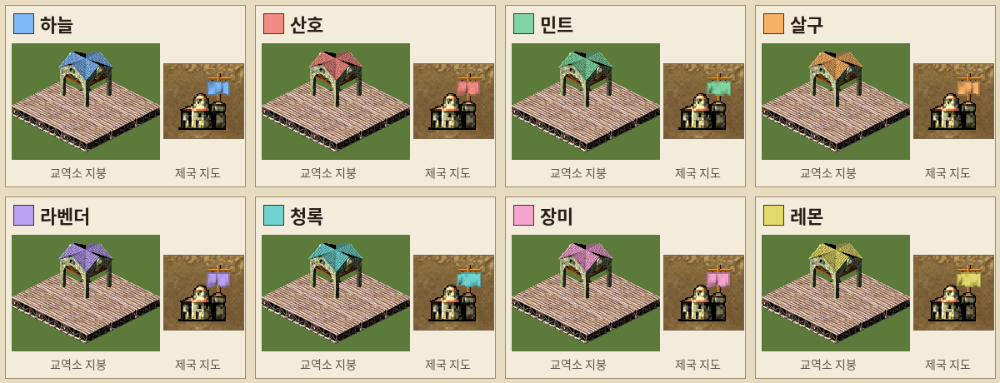
*8가지 색. 왼쪽은 그 색의 플레이어와 거래하는 교역소(게임 그림에 게임과 같은 방식으로 색을 입힌 합성), 오른쪽은 제국 지도의 그 플레이어 도시*

### 방 옵션 (방장)

방 옵션의 항목은 모두 **Augustus가 원작에 더한 고유 설정**(Augustus 옵션 창의 게임 설정과 도시 관리)을 그대로 가져온 것입니다. 이 프로젝트가 새로 만든 규칙이 아닙니다. 멀티플레이에서는 이 설정을 방장 한 사람이 정해 모두에게 똑같이 적용할 뿐입니다.

방장은 **방 옵션**에서 게임 규칙을 정합니다. 여기서 정한 값은 방의 **모든 플레이어에게 똑같이** 적용되고, 공동 저장에도 함께 저장되어 이어할 때도 그대로입니다. 한 사람만 쉬운 규칙으로 하는 일은 없습니다.

| 묶음 | 내용 |
|---|---|
| **난이도** | 난이도, 신의 축복과 저주, 신들의 질투, 도시 전체 노동력 공유, 은퇴 나이, 늑대, 병영 여러 개, 대성전 개수 등 |
| **도시 관리** | 곡물창고, 저장소, 시장의 기본 설정과 배달 규칙, 주택 병합과 확장, 배회 일꾼과 상인의 이동, 다리 철거, 나무 자동 제거, 적군 퇴각 속도, 치트 허용, 날씨 효과 등 |
| **공동 저장** | 자동 공동 저장 간격 (7장) |

화면 언어, 해상도와 창 모드, 소리, 화면 표시, 단축키는 각자 옵션 창에서 정합니다.

## 6. 게임 중

### 함께 흐르는 시간

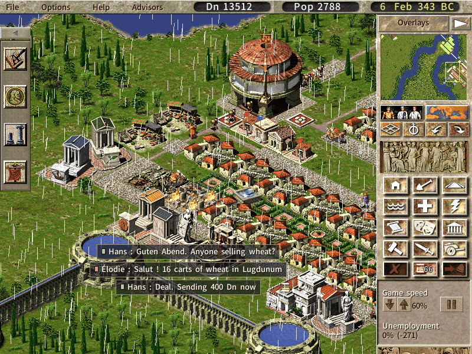
*날짜가 넘어가는 동안 도시가 계속 움직이고, 채팅이 오갑니다 (연출 화면)*

모든 도시의 달력이 함께 넘어갑니다. **게임 속도는 방장만** 바꿀 수 있고, 모든 도시에 같이 적용됩니다. 지금 속도는 왼쪽 탭에 "방장 속도"로 나옵니다.

### 왼쪽 탭

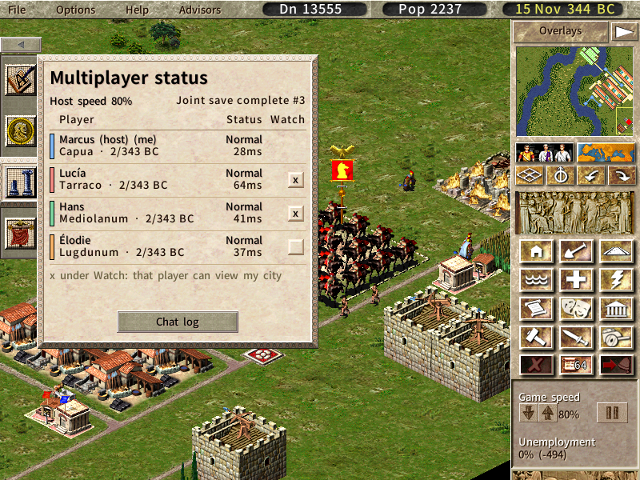
*플레이어 탭: 방장 속도, 공동 저장 상태, 플레이어별 색과 상태, 관전 허용 (연출 화면)*

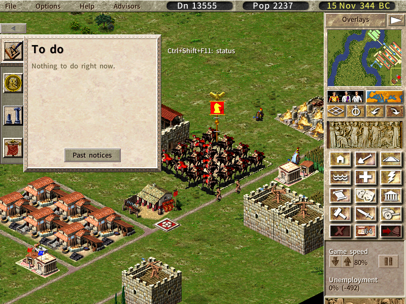
*할 일 탭*

도시 화면 왼쪽 위의 탭을 누르면 작은 창이 열립니다.
- **플레이어**: 방의 플레이어, 각자의 상태와 날짜. **관전** 칸에서 누가 내 도시를 볼 수 있는지 정합니다 (x 표시가 있는 사람만 볼 수 있습니다).
- **할 일, 알림**: 거래 제안처럼 내가 답해야 할 것과 지난 알림.
- 그 밖의 탭에서 방 속도와 저장 상태를 봅니다.

### 제국 지도

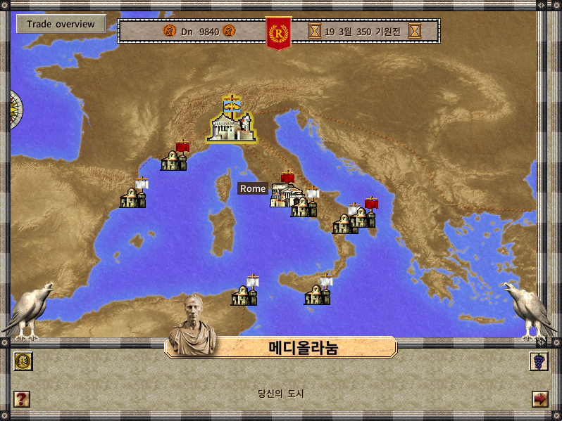
*제국 지도: 가운데 큰 도시가 내 도시이고, 내가 고른 색의 깃발이 달려 있습니다*

다른 플레이어 도시가 각자의 색 깃발로 보입니다 (5장의 색 그림). 도시 사이 교역로(육로, 바닷길)는 실제 지형을 따라 그려집니다. 로마는 모든 지도에서 같은 자리에 있는 수도입니다.

다른 플레이어 도시를 누르면 할 수 있는 일이 나옵니다.
- **교역**: 그 사람과의 거래 창을 엽니다.
- **돈 보내기**: 데나리를 직접 보냅니다. 뒤처진 이웃을 돕거나 대금을 미리 치를 때 씁니다.
- **도시 관람 / 이 도시 관전**: 그 사람의 도시를 그 사람 화면처럼 봅니다. 보기만 할 뿐 건드릴 수 없고, 상대가 허용한 경우에만 볼 수 있습니다. Esc로 내 도시로 돌아옵니다.

### 교역소와 거래

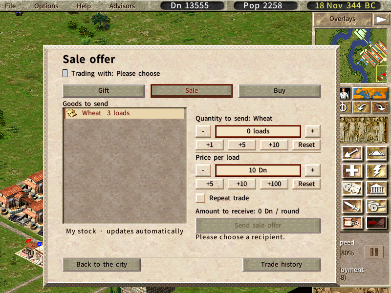
*거래 창의 판매 탭*

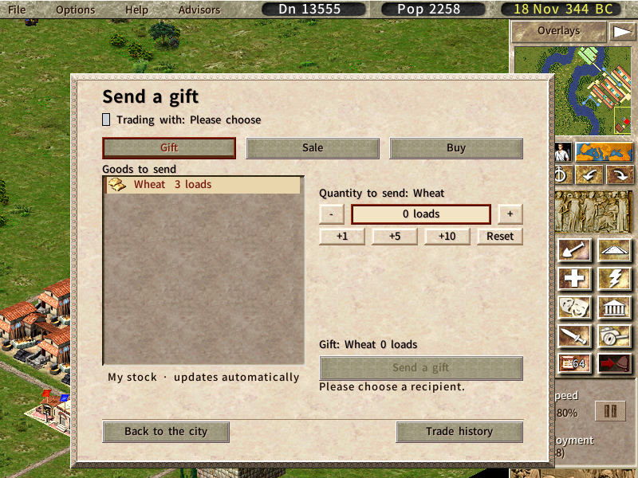
*거래 창의 선물 탭*

1. **교역소 짓기**: 거래할 상대마다 내 도시에 전용 교역소를 짓고, 도로로 도시 입구와 잇습니다. 지붕은 상대의 색입니다.
2. **거래 창**: **선물**, **판매**, **구매** 탭이 있습니다. 보낼 물품과 수량, 판매라면 짐 하나당 가격을 정해 보냅니다. **반복 거래**를 켜면 같은 거래를 계속합니다. **거래 내역**에서 지난 거래를 봅니다.
3. **운반**: 수레(육로)나 배(바닷길)가 실제로 싣고 갑니다. 시나리오가 운송 방식을 정합니다.
4. **정산**: 대금은 물품이 상대 도시에 실제로 도착했을 때 오갑니다. 운반 중인 양은 아직 상대 것이 아닙니다.
5. 상대가 접속이 끊기면 "상대 도시 재접속 대기"로 상태를 보존한 채 기다립니다. 상대가 방을 나가면 진행 중인 거래는 남은 사람에게 맞게 정리됩니다.

### 채팅

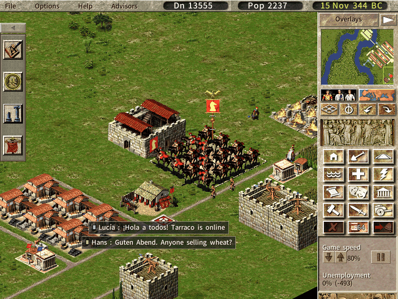
*여러 나라 플레이어의 채팅 (연출 화면)*

도시 화면에서 **Enter**를 누르면 채팅 입력줄이 열립니다. 글을 쓰고 **Enter**로 보내고, **Esc**로 닫습니다. 대기실과 게임 중 모두 **전체 채팅**과 **귓속말**을 씁니다. 이름은 각자의 색으로 나옵니다. 채팅은 번역되지 않고 쓴 그대로 모두에게 보입니다. 알림을 몇 초 동안 띄울지 정할 수 있고, 지난 대화는 채팅 기록 창에서 봅니다.

### 목표 보기
게임 화면 위쪽 메뉴의 **파일 → 공동 목표**에서 목표와 진행 상황을 봅니다. 도시 수치는 공동 검사 시점의 값으로, 납품은 실제로 도착한 누적량으로 판정합니다.

## 7. 저장과 이어하기

- **공동 저장**: 게임 화면 위쪽 메뉴의 **파일 → 공동 저장**으로 방 전체를 한 번에 저장합니다. 저장은 방장 PC에 남고, 참가자 PC마다 사본도 받아 둡니다.
- **자동 공동 저장**: 방장이 방 옵션의 **공동 저장**에서 켭니다. 5, 10, 20, 30분 간격 중에서 고릅니다. 기본은 꺼짐입니다. 저장하는 동안 도시를 잠깐 맞춘 뒤 계속 진행합니다.
- **이어하기**: 방을 만들 때 시나리오 대신 공동 저장을 고릅니다. 저장된 도시는 그대로 이어지고, 비어 있던 자리에는 새 사람이 새 도시로 들어올 수 있습니다.
- **방장이 끊겼을 때**: 참가자 PC마다 공동 저장 사본을 받아 둡니다. 방장이 끊기면 정해진 참가자가 그 사본으로 방장을 이어받고, 나머지가 다시 들어와 마지막 공동 저장부터 이어갑니다. 마지막 저장 이후의 진행은 사라집니다.

## 8. 게임 방식별 규칙

| 방식 | 내용 | 기본 시나리오 |
|---|---|---|
| **자유 건설** | 승리 조건 없이 각자 도시를 키웁니다. | 자유 건설 · 6인 |
| **공동 승리** | 정한 조건을 모두 함께 채우면 다 같이 이깁니다. | 공동 승리 · 6인 |
| **기한 경쟁** | 정한 기간이 지났을 때 한 수치가 가장 높은 도시가 이깁니다. | 제작기에서 만듭니다 |
| **황제의 순행** | 순행마다 몰래 입찰하고, 끝났을 때 총애가 가장 높은 총독이 이깁니다. | 황제의 순행 · 6인 |
| **황위 쟁탈전** | 5단계 쿠데타를 먼저 끝낸 총독이 황제가 됩니다. | Et tu, Brute? |

기본 시나리오는 한두 시간이면 끝나는 튜토리얼입니다. 더 길고 어려운 판은 시나리오 제작기로 만듭니다.

### 공동 승리
정한 조건(인구, 문화, 번영, 평화, 황제 지지도, 자금, 도시 사이 납품)을 **모두** 채운 공동 검사 시점에 함께 이깁니다. 필요한 도시의 플레이어가 없으면 판정을 미룹니다. 지는 일이나 시간제한은 없고, 이긴 뒤에도 계속 지을 수 있습니다. 뒤처진 도시를 도와야 이길 수 있습니다.

### 기한 경쟁
정한 개월 수가 지난 뒤 첫 공동 검사에서, 정한 수치가 가장 높은 도시가 이깁니다. 동점이면 함께 이기고, 그 뒤에도 플레이는 계속됩니다.

### 황제의 순행
- 시작 후 일정 기간(기본 2년) 뒤 황제가 순행을 시작합니다. 기본 6번입니다.
- 순행이 공고되면 도시 화면 오른쪽 위 상자에서 **입찰**합니다. 한 번뿐이고 다른 총독은 볼 수 없습니다.
- 가장 높게 입찰한 도시로 황제가 옵니다. 황제는 예고한 세 가지 물품 중 하나를 찾으니 미리 창고에 준비합니다.
- 넉넉히 드리면 총애가 오르고, 모자라면 총애가 떨어지고 모자란 만큼 돈으로 메웁니다.
- 순행이 모두 끝났을 때 총애가 가장 높은 총독이 이깁니다. 2명 이상이 있어야 시작할 수 있습니다.

### 황위 쟁탈전
- 처음에는 제국이 **평화로운 상태**입니다. 누군가 쿠데타를 시작하기 전까지는 평화가 이어집니다.
- 누군가 평화를 깨고 쿠데타를 시도하는 순간, 황제는 누가 했는지 모릅니다. 그래서 **나까지 포함한 모든 총독을 의심**하기 시작합니다. 가만히 있어도 의심받으니, 결국 나도 쿠데타 경쟁에 뛰어들어 먼저 황제가 되는 수밖에 없습니다.
- 도시 화면 오른쪽 위 상자에서 **쿠데타 지원**을 합니다. 5단계를 먼저 끝낸 총독이 황제가 되고, 그 순간 게임이 끝납니다.
- **편집증은 총독마다 따로 있습니다.** 황제가 나를 얼마나 의심하는지를 나타내는 수치이고, 모든 플레이어가 각자 자기 편집증을 갖고 따로 오르내립니다. 내가 선물로 낮춰도 다른 총독의 편집증은 그대로입니다.
- 쿠데타는 익명입니다. 실패하면 **모든 총독의 편집증이 각각** 오릅니다.
- 편집증이 100이 되면 황제가 그 도시로 **징벌 원정군**을 보냅니다. **충성선물**로 편집증을 낮추거나, **공물**을 바치거나, 군대로 막습니다.

(시나리오 이름을 농담으로 "브루투스, 너마저?"라고 지을까 고민하다가, 결국 그렇게 지었습니다. 기본 시나리오 이름이 **Et tu, Brute?** 입니다.)

## 9. 시나리오 제작기

메인 메뉴의 **멀티 시나리오 제작기** 단추로 엽니다.

### 제작기는 이렇게 만들어졌습니다

- 시저 3의 모든 캠페인 지도에서 **지형만** 가져왔습니다. 원래 캠페인의 목표와 이벤트는 모두 빼고, 빈 도시만 남겨 두었습니다. 그 위에 내 시나리오의 목표, 이벤트, 침략을 새로 정합니다.
- 그래서 제작기를 **처음 열 때는 내 시저 3 원본 자료를 읽느라 잠시 기다립니다.** 읽어 온 도시들은 제국 지도에 놓입니다.
- 제국 지도의 점 색깔은 이렇습니다.
    - **연두색**: 지형이 있는 캠페인 지도입니다. 바로 플레이어 도시로 쓸 수 있습니다.
    - **보라색**: 캠페인에 중립 도시로만 나오고 지형이 없는 도시입니다.
- 보라색 도시도 플레이 도시로 만들 수 있습니다. 시저 3 지도를 나누는 사이트에서 받은 지도 파일(`.mapx`)이나 저장 파일(`.svx`)을 그 도시에 넣으면 됩니다.

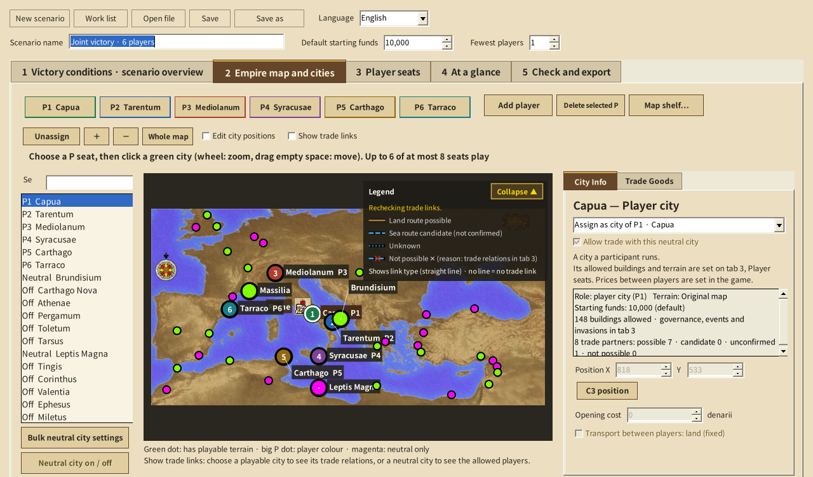
*2단계 제국지도와 도시: 연두색 점은 지형이 있는 도시, 보라색 점은 지형이 없는 중립 도시, 번호가 붙은 큰 점은 플레이어 자리*

### 다섯 단계

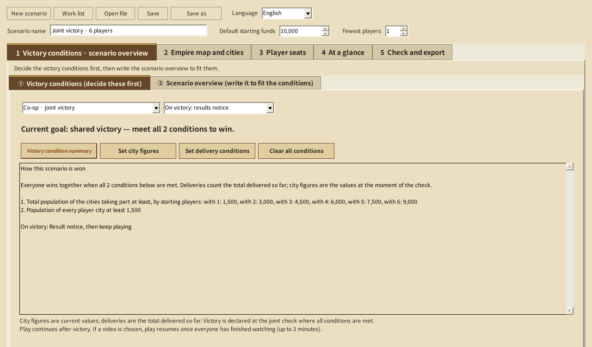
*1 승리 조건*

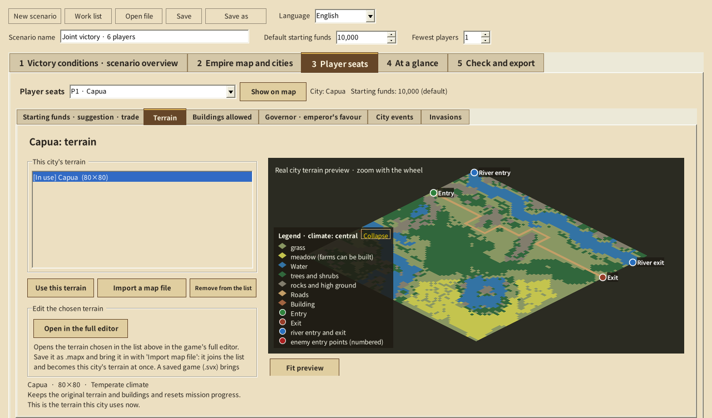
*3 지형*

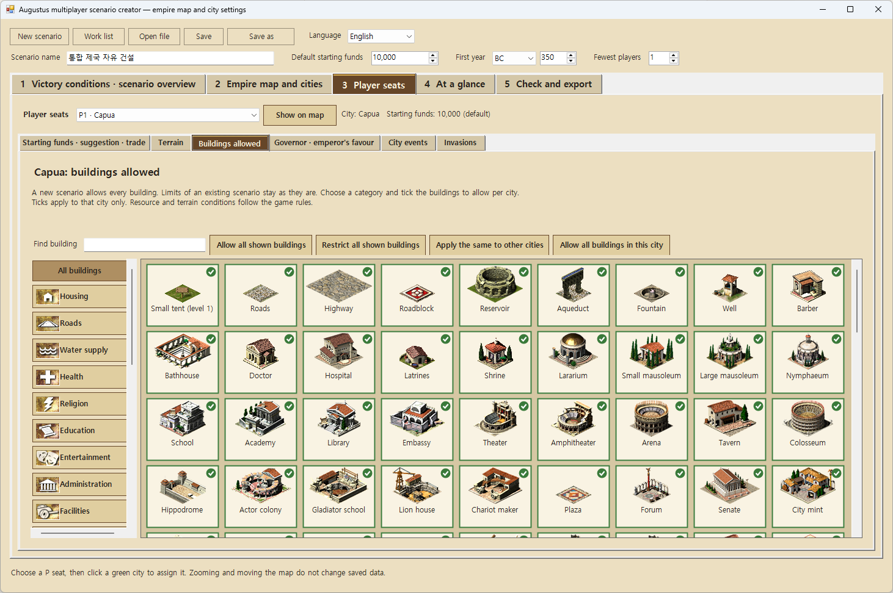
*3 건설 허용*

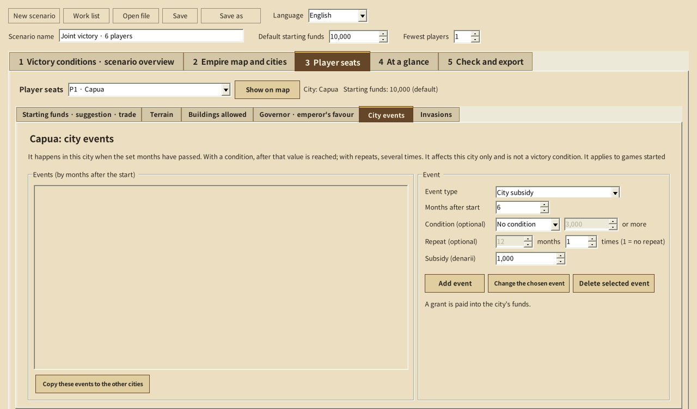
*3 도시 이벤트*

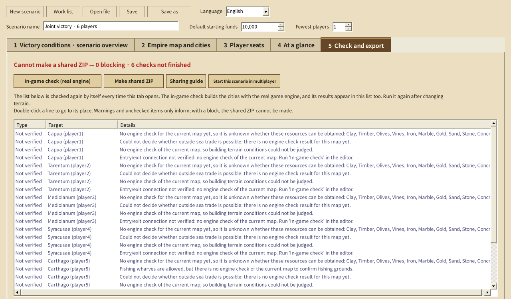
*5 검증과 내보내기*

위쪽 다섯 단계를 순서대로 진행합니다.

| 단계 | 하는 일 |
|---|---|
| **1 승리 조건 · 시나리오 개요** | 승리 조건을 고릅니다: 자유 건설, 협동(공동 승리), 경쟁(기한 경쟁, 황제의 순행, 황위 쟁탈전). 공동 승리는 도시 수치와 도시 사이 납품 과제(최대 16개)를 정합니다. 경쟁 방식은 프리셋을 고르거나 세부 수치를 정합니다. 제목, 방에서 보는 소개 글, 게임 시작 때 뜨는 메시지도 씁니다. |
| **2 제국지도와 도시** | 원작 제국 지도에서 플레이어 도시 자리(최대 8개, 그중 6명까지 플레이)와 중립 도시를 고릅니다. 중립 도시마다 교역 품목과 거래량, 어느 플레이어와 교역할 수 있는지를 정합니다. 로마는 고정된 수도입니다. |
| **3 플레이 자리 설정** | 자리를 하나 고르고 아래 탭에서 설정합니다. **시작 자금 · 추천 · 교역** / **지형** (원작 지도 가져오기, 정식 지형 편집기) / **건설 허용** / **통치자 · 황제 지지도** / **도시 이벤트** (도시마다 최대 32개) / **침략** (도시마다 최대 16번). |
| **4 한눈에 보기** | 기본값과 다르게 정한 것을 한 장에 모아 보여 줍니다. |
| **5 검증 · 내보내기** | 자동 검사 목록이 나옵니다. 항목을 두 번 누르면 고칠 곳으로 갑니다. **게임 적용 검사 (실제 엔진)**로 실제 엔진에서 도시를 만들어 봅니다. **공유 ZIP 만들기**로 친구에게 줄 파일을 만들고, **이 시나리오 멀티시작**으로 바로 방을 엽니다. |

- 원작 시저 3 파일은 고치지 않습니다. 가져온 지도와 지형은 시나리오 안에 따로 저장됩니다.
- 친구가 준 공유 ZIP은 제작기의 **작업 목록**에서 **공유 ZIP 가져오기**로 가져옵니다.
- 제작기도 게임의 화면 언어를 따르고, 위쪽에서 따로 고를 수도 있습니다.

## 10. 자주 묻는 것

- **"게임 버전이 다릅니다"**: 방의 모든 사람이 같은 배포 파일을 써야 합니다.
- **방이 안 보여요**: 같은 네트워크인지, 방장이 고른 네트워크와 같은지 확인하고 방장 IP를 직접 넣어 보세요. Windows 방화벽이 막고 있지 않은지도 확인하세요.
- **도시와 건물 이름이 다른 언어로 나와요**: 시저 3 자체의 글은 내가 가진 시저 3의 언어로 나옵니다 (1장).
- **번역이 어색해요**: 기계 번역입니다. [Issues](https://github.com/the-akansas/augustus-iris/issues)에 화면과 함께 알려 주세요.
- **깃발이 원래 색으로 나와요**: 시저 3 폴더의 그림을 읽지 못한 것입니다. 폴더가 맞는지 확인하세요.
- **시저 3 폴더를 다시 고르고 싶어요**: 게임을 끄고 `Augustus` 폴더의 `network-settings.json`과 `network-settings.json.backup`을 지운 뒤 다시 실행합니다.
- **오류를 알리고 싶어요**: [Issues](https://github.com/the-akansas/augustus-iris/issues)에 메인 메뉴의 버전, 화면 언어, 무엇을 하다가 생겼는지를 적어 주세요.
