# Augustus - Iris manual

**English** · [한국어](MANUAL.ko.md) · [README](README.md)

## Contents
1. Install and first start
2. Playing with friends far away (internet)
3. Create a room (host)
4. Join a room
5. Waiting room and room options
6. In the game
7. Saving and continuing
8. Game modes
9. Scenario editor
10. Questions

---

## 1. Install and first start

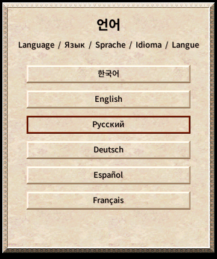
*Choosing the display language on first start*

1. Download `Augustus-MP-<version>-global.zip` from [Releases](https://github.com/the-akansas/augustus-iris/releases/latest).
2. Extract **all of it** into a folder. Run from inside the zip and the game cannot save its settings.
3. Run `Play.cmd`.
4. Choose the **display language**: English, 한국어, Русский, Deutsch, Español or Français. You can change it later in the options.
5. Choose your **Caesar III folder**, the one that holds `c3.sg2`. It is remembered.

The game opens on the Augustus main menu. This project adds two buttons:

- **Multiplayer**: create a room or join someone else's (chapters 3 and 4).
- **Multiplayer scenario creator**: make and edit multiplayer scenarios (chapter 9).

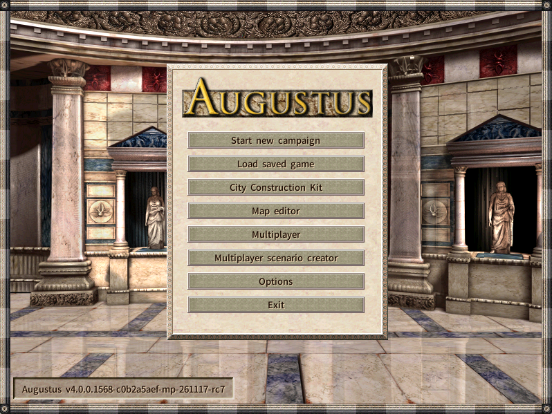
*Main menu: the buttons this project adds are Multiplayer and Multiplayer scenario creator*

The other buttons (new campaign, saved games, City Construction Kit, map editor, options) are Augustus as it is, so
single-player Caesar III is still there too.

On first start the flag cloth and the trade post roofs are made from your own Caesar III graphics. Your Caesar III
install is only read; the game runs on a private copy inside its own folder.

**Texts of Caesar III itself** (city names, building names, advisors) **come in the language of your Caesar III**:
English with an English copy, German with a German one. The screens this project adds (rooms, trade, chat, editor)
come in the display language you chose. (The order of the language list will keep changing: the languages people ask
about most move up. A friendly race between languages. The top spot, though, belongs to Korean.)

**Only when you move to a new version**, use `Import-previous-settings.cmd`. A first install does not need it. Run it,
pick the folder of the old version, and your game settings, hotkeys, Caesar III folder, recent IPs and names, and your
own scenarios come over to the new folder. Joint saves do not.

## 2. Playing with friends far away (internet)

If everyone is on the same router, at the same home or office, skip this chapter.

This edition has no public server and no accounts. A room is one TCP port (48921) on the host's PC, and the others
join by IP. To play with people who are not on your router, do one of these:

- **Virtual LAN** (easy): everyone joins the same virtual LAN (Radmin VPN, Tailscale, ZeroTier...). The host chooses that virtual LAN's address under "Network to use", and the others join that address.
- **Open a port**: on the host's router, forward TCP 48921 to the host's PC; the others join the host's public IP.

`Internet-play.txt` in the download explains both step by step.

## 3. Create a room (host)

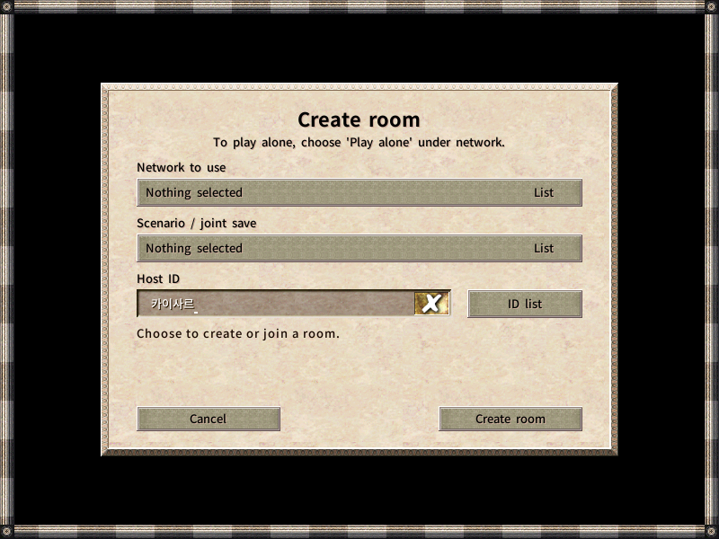
*Create room*

1. In the main menu press **Multiplayer**, **LAN play**, then **Create room**.
2. **Network to use**: the network the others will join through.
    - **Friends at the same home or office**, on the same router: choose that router's network (usually Ethernet or Wi-Fi).
    - **Friends far away**: use a virtual LAN program. With a free program such as Radmin VPN, ZeroTier or Tailscale, once everyone has joined the same network, you are connected as if you shared one router. Choose that program's network. Chapter 2 has the details.
    - **Trying it alone**: choose **Play alone (this PC only)**.
3. **Scenario / joint save**: a built-in scenario, one you made, or a joint save to continue. Click an item to see its map and description.
4. Enter your **name** and press **Create room**. The room shows your IP; give it to the others.

## 4. Join a room

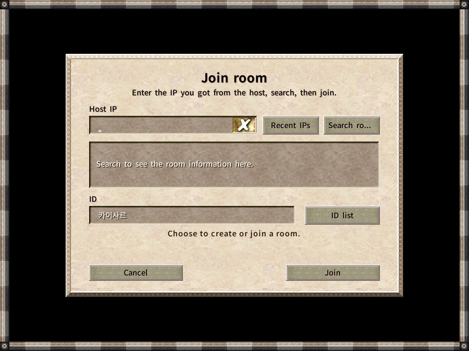
*Join room*

1. In the main menu press **Multiplayer**, **LAN play**, then **Join room**.
2. **Search** your network for rooms, or type the host's IP. **Recent IPs** lists the ones you used before.
3. A room you cannot join says why (full, already started, another version...).
4. Enter your name and press **Join**.

Everyone in a room needs **the same version**. The version is shown on the main menu and in the waiting room.

## 5. Waiting room and room options

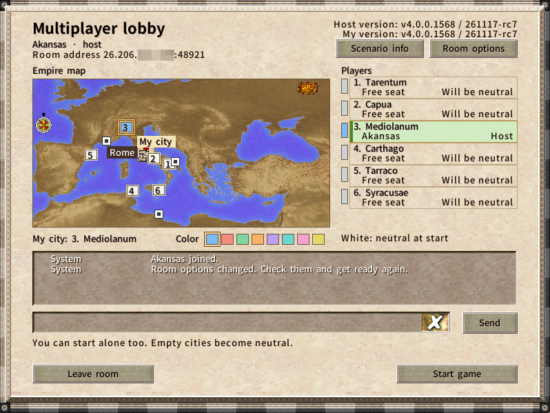
*Waiting room: city seats, players, colour choice, chat*

- The scenario's empire map shows the city seats. Hover a seat to preview that city's land.
- Pick your **city seat** and your **colour**, then press **Ready**.
- **Choose your colour with care.** It stands for you for the whole game.
    - On the other players' empire maps, your city's flag has this colour.
    - The trade post another player builds to trade with you has a roof in this colour. However many trade posts a city has, the roof tells whose post it is.
    - Your name in the chat, your row in the players tab and your legions' flags use it too.
    - So pick one that stands out and does not get confused with the others. There are eight.

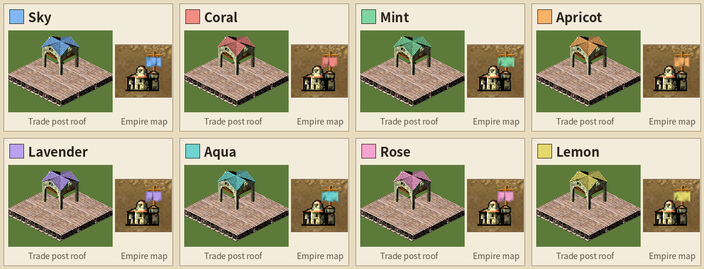
*The eight colours. Left: the trade post of a player with that colour (the game's own picture, coloured the way the game does it). Right: that player's city on the empire map.*

- Talk in the waiting room chat.
- When everyone is ready, the host starts. Seats nobody took become neutral cities. If someone leaves during the start, the start is cancelled; just start again.

### Room options (host)

Every item in the room options is **one of Augustus's own settings** (the gameplay and city management options
Augustus added to the original game), taken as they are. This project made no new rules here. In multiplayer, the
host simply sets them once and they apply to everyone.

Whatever the host sets applies **the same to every player**, and is kept in the joint save for when you continue. Nobody
plays with easier rules than the others.

| Group | What it holds |
|---|---|
| **Difficulty** | difficulty, gods' blessings and curses, jealous gods, shared workforce, retirement age, wolves, several barracks, number of grand temples, and more |
| **City management** | defaults and delivery rules of granaries, warehouses and markets, house merging and growth, walkers and traders, bridges, trees, enemy retreat speed, cheats, weather, and more |
| **Joint save** | automatic joint save interval (chapter 7) |

Display language, resolution and window mode, sound, display and hotkeys stay each player's own, in the options window.

## 6. In the game

### One clock for everyone

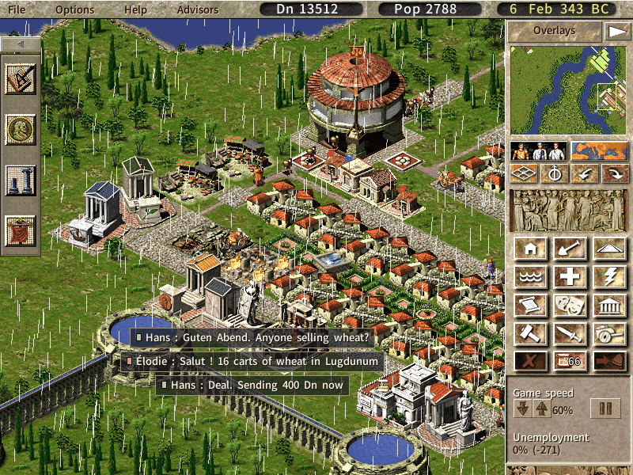
*The date moves on, the city keeps running and the chat goes on (staged screen)*

All cities' calendars turn together. **Only the host** changes the game speed, and it applies to every city. The left
tab shows it as "Host speed".

### Left tabs

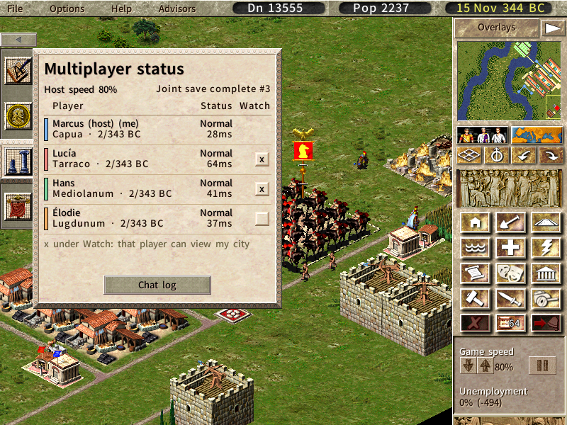
*Players tab: host speed, joint save state, each player's colour and state, and who may watch your city (staged screen)*

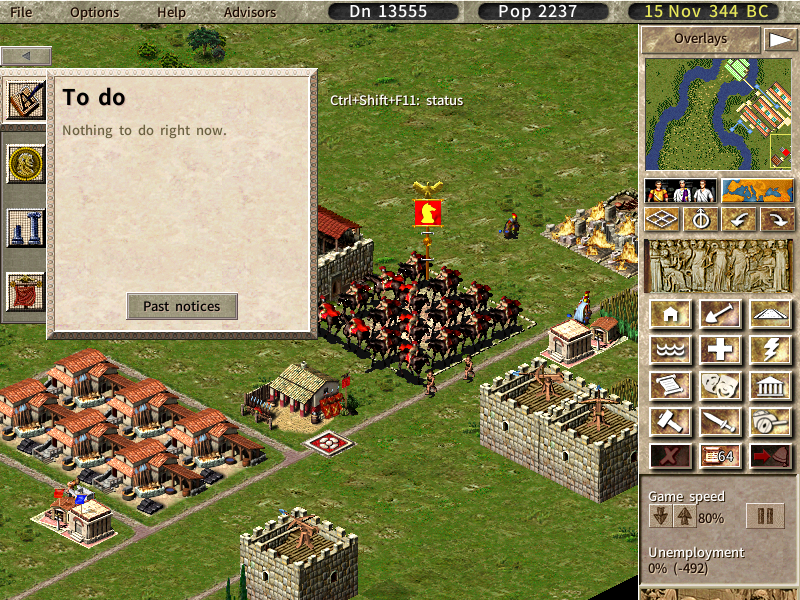
*To do tab*

The tabs at the top left of the city screen open small windows.
- **Players**: the players of the room, their state and date. In the **Watch** column you choose who may view your city (only players with an x can).
- **To do, notices**: what you have to answer, such as trade offers, and past notices.
- The other tabs show the room speed and the save state.

### Empire map

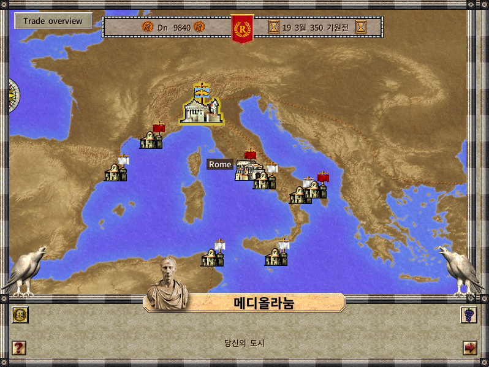
*Empire map: the big city in the middle is mine, flying the colour I chose*

The other players' cities fly their colours (see the colour picture in chapter 5). Trade routes between cities (land and
sea) follow the real terrain. Rome is the capital, in the same place on every map.

Click another player's city for what you can do:
- **Trade**: opens your trade window with that player.
- **Send money**: sends denarii directly, to help a neighbour who fell behind or to pay in advance.
- **View city**: shows that player's city as they see it. You can only look, never touch, and only if they allow it. Esc brings you back to your city.

### Trade posts and trading

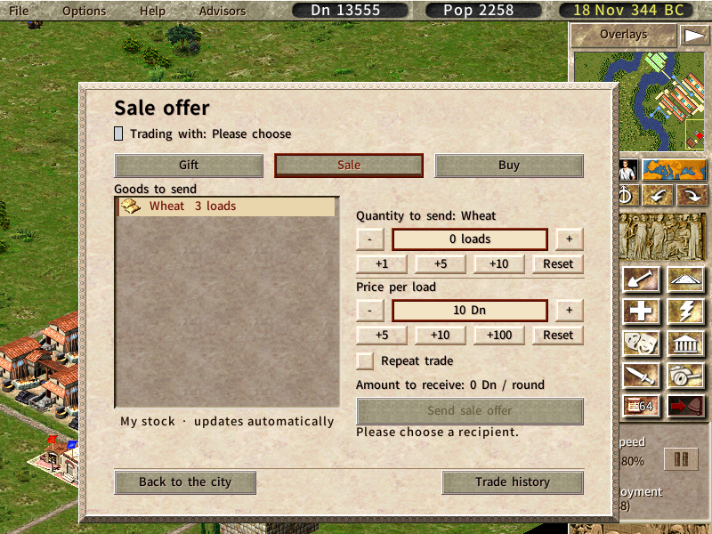
*Sale tab of the trade window*

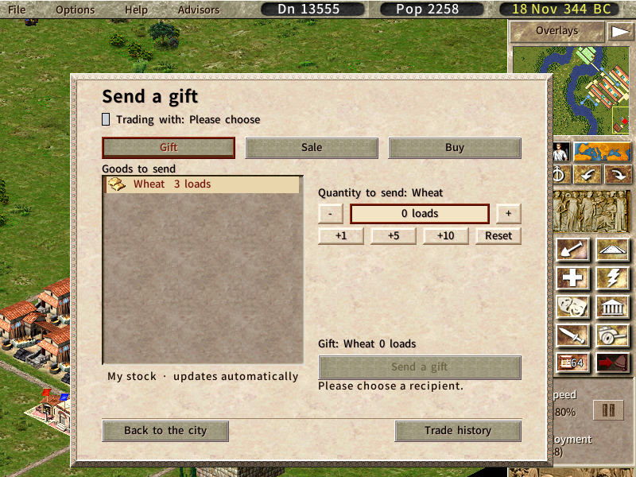
*Gift tab of the trade window*

1. **Build a trade post**: one in your city for each partner, connected by road to the city entrance. Its roof has the partner's colour.
2. **Trade window**: **Gift**, **Sale** and **Buy** tabs. Choose the goods and the amount, and for a sale the price per load. **Repeat trade** keeps doing the same trade. **Trade history** lists past trades.
3. **Transport**: carts (land) or ships (sea) really carry the goods. The scenario decides which.
4. **Payment**: money moves when the goods actually arrive in the other city. What is on the road is not theirs yet.
5. If the partner disconnects, the trade waits with its state kept ("Waiting for the other city to reconnect"). If the partner leaves the room, trades under way are settled for those who stay.

### Chat

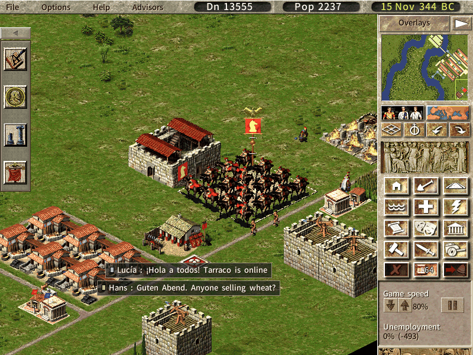
*Players from many countries chatting (staged screen)*

In the city screen press **Enter** to open the chat line, type, press **Enter** to send, and **Esc** to close it. Chat
works in the waiting room and in the game, to **everyone** or as a **whisper** to one player. Names show in each
player's colour. Messages are not translated: everyone sees them as written. You can choose how many seconds a message
stays on screen, and read older ones in the chat log.

### Goals

Open **File → Joint goal** in the menu at the top of the game screen to see the goals and the progress. City figures
count as they are at the joint check; deliveries count what has actually arrived.

## 7. Saving and continuing

- **Joint save**: **File → Joint save** in the menu at the top of the game screen saves the whole room at once. The save stays on the host's PC, and every player's PC keeps a copy.
- **Automatic joint save**: the host turns it on under **Joint save** in the room options, every 5, 10, 20 or 30 minutes. It is off by default. While saving, the cities are lined up for a moment and then go on.
- **Continue**: when creating a room, choose a joint save instead of a scenario. Saved cities go on as they were, and an empty seat can take a new player with a new city.
- **If the host drops**: every player's PC holds a copy of the joint save. The chosen player takes over as host from that copy, the others join again, and the game goes on from the last joint save. What happened after that save is lost.

## 8. Game modes

| Mode | What it is | Built-in scenario |
|---|---|---|
| **Free building** | No victory conditions; everyone grows their city. | Free build · 6 players |
| **Joint victory** | Meet all the set conditions together and everyone wins. | Joint victory · 6 players |
| **Deadline race** | When the time is up, the city with the highest figure wins. | made in the editor |
| **The emperor's tour** | Bid in secret for each visit; the highest favour at the end wins. | The emperor's tour · 6 players |
| **Race for the throne** | The first governor to finish a five-stage coup becomes emperor. | Et tu, Brute? |

The built-in scenarios are tutorials that end in an hour or two. Longer and harder games are made with the scenario
editor.

### Joint victory
Everyone wins together at the joint check when **all** conditions (population, culture, prosperity, peace, favour,
funds, deliveries between cities) are met. If a city the goal needs has no player, the check waits. There is no losing
and no time limit, and you can keep building afterwards. You only win by helping the cities that fall behind.

### Deadline race
At the first joint check after the set number of months, the city with the highest chosen figure wins. A tie means a
shared win, and play goes on afterwards.

### The emperor's tour
- After a while (two years by default) the emperor starts his tours, six by default.
- When a tour is announced, **Place bid** in the box at the top right of the city screen. Once only, and no other governor sees it.
- The emperor visits the highest bidder. He asks for one of three announced goods, so have them ready in your warehouses.
- Give him plenty and your favour rises; fall short and it drops, and the shortfall is paid in money.
- After the last tour, the governor with the highest favour wins. It needs at least two players.

### Race for the throne
- The empire starts **at peace**, and peace lasts until someone starts a coup.
- The moment someone breaks the peace and tries a coup, the emperor does not know who it was. So **he suspects every governor, you included**. Staying quiet will not save you from suspicion, so in the end you too must join the race and become emperor first.
- Use **Coup support** in the box at the top right of the city screen. The first governor to finish five stages becomes emperor, and the game ends at that moment.
- **Paranoia is separate for every governor.** It is how much the emperor suspects you, and every player has their own, rising and falling on its own. Lowering yours with gifts leaves the others' as they are.
- Coups are anonymous. A failed one raises **every governor's paranoia, each their own**.
- At 100 paranoia the emperor sends a **punitive expedition** to that city. Lower your paranoia with **loyalty gifts**, pay **tribute**, or fight it off.

(I thought about naming the scenario "Et tu, Brute?" as a joke, and then I did. That is the built-in scenario's name.)

## 9. Scenario editor

Open it with the **Multiplayer scenario creator** button in the main menu.

### How the editor is built

- From every campaign map of Caesar III, **only the land** was taken. The campaigns' own goals and events were all left out, leaving empty cities. You set your scenario's goals, events and invasions on top.
- So **the first time the editor opens, it waits a little while it reads your Caesar III data.** The cities it reads are placed on the empire map.
- The dots on the empire map:
    - **Green**: a campaign map with land. It can be a player city right away.
    - **Magenta**: a city that appears only as a neutral city in the campaigns, without land.

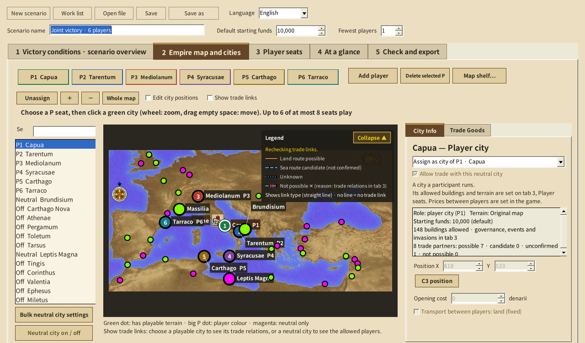
*Step 2, empire map and cities: green dots have land, magenta dots are neutral cities without land, big numbered dots are player seats*

- A magenta city can become a player city too: put a map file (`.mapx`) or a save file (`.svx`) from a Caesar III map sharing site into it.

### Five steps

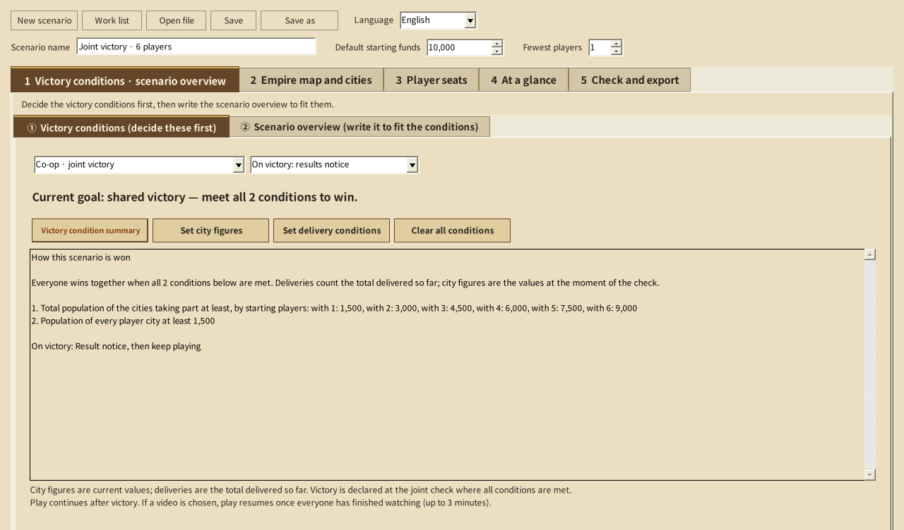
*Step 1: victory conditions*

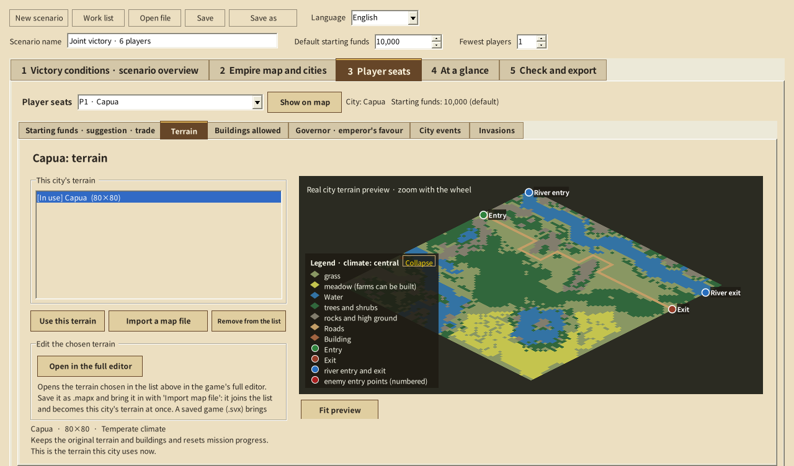
*Step 3: terrain*

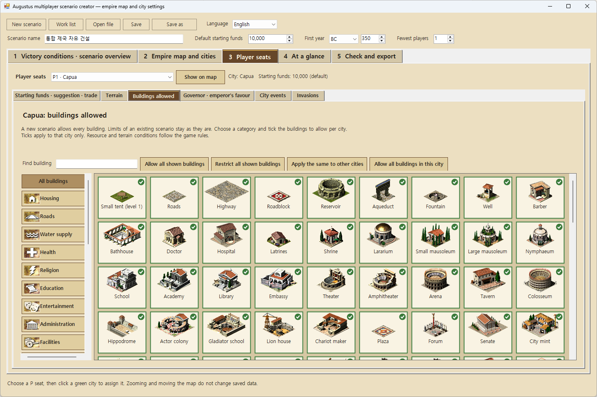
*Step 3: buildings allowed*

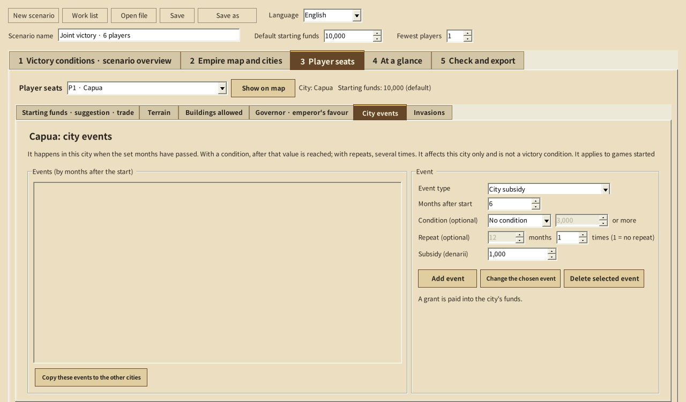
*Step 3: city events*

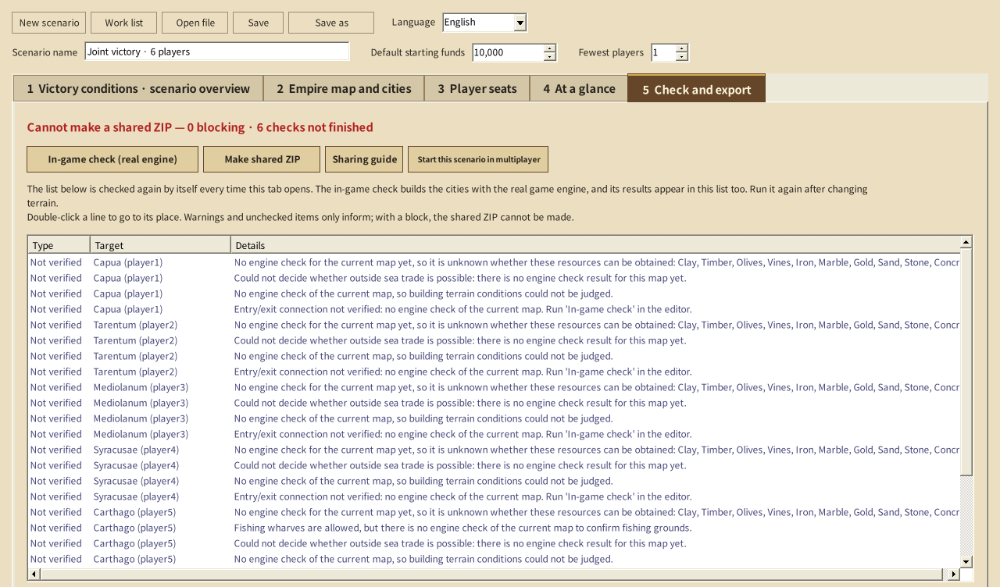
*Step 5: check and export*

Go through the five steps at the top in order.

| Step | What you do |
|---|---|
| **1 Victory conditions · scenario overview** | Choose the victory conditions: free building, co-op (joint victory), or competition (deadline race, the emperor's tour, race for the throne). Joint victory sets city figures and delivery tasks between cities (up to 16). Competitions take a preset or detailed numbers. Also write the title, the text shown in the room, and the messages at the start. |
| **2 Empire map and cities** | On the original empire map, choose the player city seats (up to 8, of which up to 6 play) and the neutral cities. For each neutral city set what it trades, how much, and with which players. Rome is the fixed capital. |
| **3 Player seats** | Choose a seat and set it in the tabs below: **starting funds · suggestion · trade** / **terrain** (import an original map, full terrain editor) / **buildings allowed** / **governor · emperor's favour** / **city events** (up to 32 per city) / **invasions** (up to 16 per city). |
| **4 At a glance** | Everything you changed from the defaults, on one page. |
| **5 Check and export** | The automatic checks are listed; double-click one to go where it needs fixing. **In-game check (real engine)** builds the cities with the real engine. **Make shared ZIP** makes the file you give your friends, and **Start this scenario in multiplayer** opens a room right away. |

- The original Caesar III files are never changed. Imported maps and land are kept inside the scenario.
- A shared ZIP from a friend comes in with **Import shared ZIP** in the editor's **Work list**.
- The editor follows the game's display language, and has its own language choice at the top as well.

## 10. Questions

- **"The game version is different"**: everyone in the room needs the same download.
- **I cannot see the room**: check you are on the same network the host chose, and try typing the host's IP. Check that Windows Firewall is not blocking it.
- **City and building names are in another language**: Caesar III's own texts come in the language of your Caesar III (chapter 1).
- **A translation reads oddly**: it is a machine translation. Tell us in [Issues](https://github.com/the-akansas/augustus-iris/issues), with a screenshot.
- **The flags keep their original colours**: your Caesar III graphics could not be read. Check the folder.
- **I want to choose the Caesar III folder again**: close the game, delete `network-settings.json` and `network-settings.json.backup` in the `Augustus` folder, and start again.
- **I want to report a problem**: open an [Issue](https://github.com/the-akansas/augustus-iris/issues) with the version shown on the main menu, your display language, and what you were doing.
