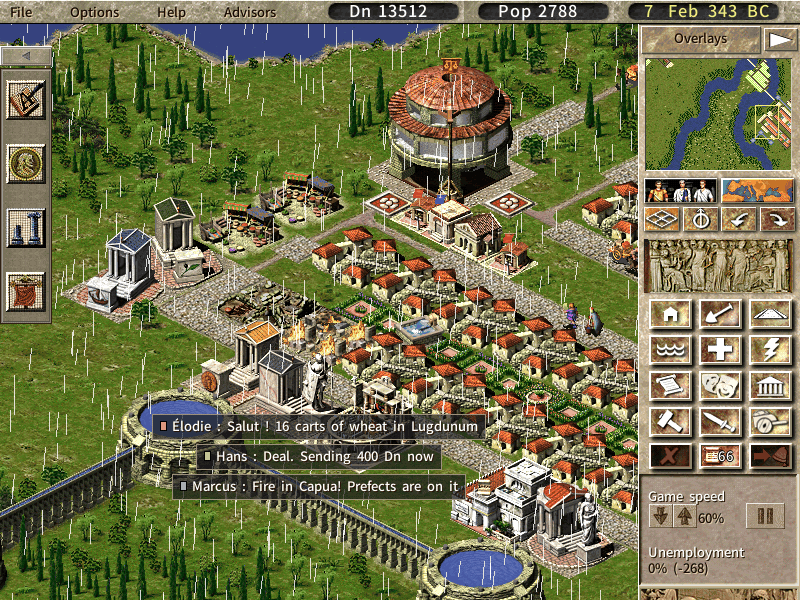
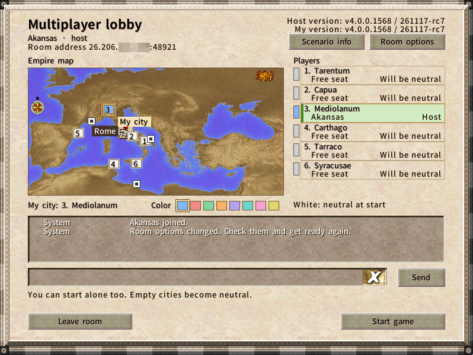
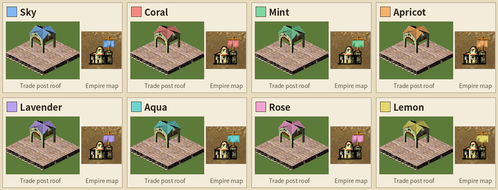
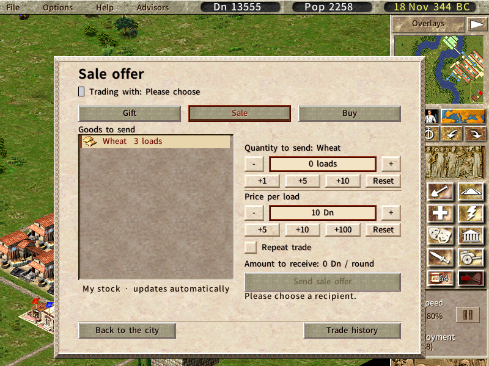
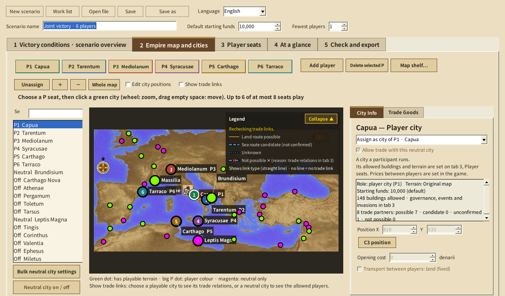

# Augustus - Iris : Alea iacta est

*Multiplayer for Caesar III*



**[Download the latest release](https://github.com/the-akansas/augustus-iris/releases/latest)** · [Manual](MANUAL.md) · [메뉴얼 (한국어)](MANUAL.ko.md) · [Report a problem or ask a question](https://github.com/the-akansas/augustus-iris/issues)

Multiplayer for **Caesar III**, built on [Augustus](https://github.com/Keriew/augustus), the open-source
re-implementation of the game. Up to six players each build their own city on the same empire map, trade with each
other through their own trade posts and roads, send each other money, and race toward shared or personal goals. A
scenario editor makes multiplayer scenarios.

**Read the introduction in your language** (click to open):

<details>
<summary><b>한국어</b></summary>

#### 같은 꿈속에서

같은 음악을 좋아하는 사람을 만나 본 적이 있나요? 같은 그림을 좋아하는 사람은요?

같은 장르를 좋아해도, 가장 아끼는 한 곡은 저마다 다릅니다. 그렇다면 음악과 그림과 이야기를 한데 담은 영화는
어떨까요. 같은 영화를 사랑하는 사람이라면, 어쩌면 가장 친한 친구가 될지도 모릅니다.

그럼 게임은요?

게임에는 영화처럼 음악과 그림과 이야기가 있습니다. 그리고 영화에는 없는 것이 하나 더 있습니다.
**그 세계 안으로 직접 들어가는 경험**입니다. 영화 속 주인공은 밖에서 지켜볼 뿐이지만, 게임에서는 내가 그 세상에
녹아듭니다.

그 경험을 함께 느끼고 좋아해 주는 사람이 있다면, 그 사람은 아마 나와 가장 닮은 사람일 겁니다.
같은 꿈을 꾸고, 같은 공간에 있는 사람일지도 모릅니다.
(저는 늘 사랑하는 사람과 함께 멀티플레이 게임을 하는 상상을 합니다. 같은 게임을 좋아하는 사람이 배우자라면, 세상에 평화가 찾아올 겁니다. 진정한 팍스 로마나(로마의 평화)죠.)

밤마다 꾸는 꿈속으로 나와 취향이 꼭 맞는 누군가가 찾아와 함께 시간을 보내는 것. 그 경험을 만들어 드리고 싶었습니다.

**소개합니다. Augustus - Iris : Alea iacta est 입니다.**

#### 컨셉: 멈추지 않는 하나의 시간

**하츠 오브 아이언 4**의 멀티플레이 방식에서 영감을 받았습니다.

- **모두가 같은 시간을 삽니다.** 모든 도시의 달력이 함께 넘어갑니다. 누군가 고민하는 동안에도 다른 도시는 계속 자랍니다.
- **시간은 멈추지 않습니다.** 혼자 할 때처럼 멈춰 놓고 천천히 생각할 수 없습니다. 흘러가는 시간 속에서 끊임없이 선택하고 발전해야 합니다.
- **이웃은 곧 교역 상대이자 경쟁자입니다.** 무엇을 직접 만들고 무엇을 이웃에게서 사 올지, 언제 돕고 언제 앞서 나갈지 계속 판단해야 합니다.
- **혼자가 아닙니다.** 싱글플레이를 하듯, 대부분의 경우 당신이 보는 게임의 속도는 지연되지 않습니다. 하지만 채팅, 교역, 협력을 하며 멀티플레이의 쾌감을 느낄 수 있습니다.

#### 같이 뭐 하고 놀까요?

저는 이 게임의 "연결"까지만 만들었습니다.

처음 이 프로젝트를 시작할 때 제 고민은 "같이 놀 수 있을까?"였습니다. 시험을 마친 지금, 고민은 "같이 뭐 하고 놀지?"로
바뀌었습니다.

AI에게 수없이 물어봤지만, 시나리오는 AI가 할 수 없는 영역이었습니다. 그럴듯한 이야기는 지어낼 수 있어도, 도시 사이의
무역 균형이나 도시가 어떻게 커 가는지에 대한 사람의 감각은 없었습니다. 그래서 바로 시험해 볼 수 있는 예제 시나리오를
넣어 두긴 했지만, 균형이 형편없어서 재미는 없을 겁니다.

제 목표는 재미있게 놀 수 있는 마당을 만드는 것이었고, 그건 이뤘다고 생각합니다. 시나리오 에디터에는 시저 3의 거의
모든 것을 담았습니다. 당신의 이야기를 담아 친구와, 여유가 된다면 만든 저와도 함께 나누며 재미있게 노는 것. 그것이
제 꿈입니다.

제 꿈에 들어와 주실래요?

#### 이 프로젝트를 만든 방식

기획과 글은 제가 썼고, 코드는 100% AI가 작성했습니다. Codex Astra(medium 추론)와 Claude Opus 5.5(중간 추론)를 함께 썼습니다.

저는 5년 동안 프로그래머로 일하며 여러 프로젝트에서 C, Java, Python을 써 왔고, 코드를 읽을 줄 압니다.
그래도 이번에는 코드는 제쳐 두기로 했습니다. 모두와 함께 놀기 위해, 오로지 나와 취향이 닮은 당신을 찾기 위해 만든
프로젝트이고, 목표는 빠른 개발이었습니다. 그래서 코드를 검수하지 않았고, AI가 쓴 코드를 그대로 올립니다.

제 힘은 다국어 구현과 멀티플레이 안정화에 쏟았습니다. 코드 검수를 하지 않았기 때문에, 이 프로젝트에 대한 질문에는
AI의 자문을 받아 제가 아는 범위 안에서 답하고, 고칠 것은 수정에 반영하겠습니다.

혹시 AI가 만들었다는 이유만으로 이 프로젝트가 싫으시다면, 그래도 꼭 한 번은 플레이해 보시길 권하고 싶습니다.
이 프로젝트는 AI의 우월함이나 생산성을 증명하려는 것이 아닙니다. 20년 전으로 돌아가 시저 3를 사랑하던 제 꿈속으로
당신을 초대하는 것, 혹은 당신의 꿈속에 찾아가 같은 것을 좋아하는 또 다른 나를 만나기 위한 프로젝트라는 것을
알아 주셨으면 좋겠습니다.

저는 코딩을 할 줄 알고 읽을 줄도 알지만, 디자인은 잘 모르고 외국어는 더더욱 모릅니다. 그럼에도 더 많은 나를 찾고
만나기 위해 다국어 지원을 넣었습니다. 게임에 설정한 언어가 서로 달라도, 우리가 한 방에서 만난다면 당신은 제가 하는
이야기를 볼 수 있습니다. (주의: 채팅을 번역해 준다는 뜻은 아닙니다.)
물론 게임 속 단어들은 기계 번역이라, 실제로 당신이 쓰는 단어나 문장과 달라 어색할 수 있습니다. Issues에 지적해
주시면 고쳐 두겠습니다.

떨리는 마음으로 준비했지만, 여전히 이 프로젝트가 당신에게 어떤 오해를 사지 않을까 걱정이 됩니다.

저는 코드를 직접 쓰기보다, 무엇을 만들지 고민하는 데 시간을 썼습니다. 스티브 잡스나 코지마 히데오가 그랬던 것처럼요.
(물론 그분들과 견주려는 것은 아닙니다.) 그래서 이 게임이 속에서 어떻게 돌아가는지 구석구석 알지는 못합니다.
게다가 이 프로젝트는 Augustus에서 갈라져 나온 것이라, 제 포트폴리오라고 말할 수도 없습니다.
그래서 프로그램 어디에도 제 흔적을 남기지 않았습니다.

누군가 이 프로젝트를 가져가 "내가 만들었다"고 해도 화내지 않겠습니다.
다만 원조라고 주장하시려면, 끝까지 한국인이라고 주장해 주세요. 원조는 한국인이거든요.

모쪼록 재미있게 즐겨 주시고, 언젠가는 당신과 함께 시저 3에 대해 이야기 나눌 날이 오기를 바랍니다.

설치와 사용법: [한국어 메뉴얼](MANUAL.ko.md).

</details>
<details>
<summary><b>Русский</b></summary>

#### В одном сне

Встречали ли вы человека, который любит ту же музыку, что и вы? Те же картины?

Даже у тех, кто любит один жанр, у каждого свой любимец. А фильмы, в которых сразу и музыка, и картины, и история?
Двое, полюбившие один и тот же фильм, вполне могут стать лучшими друзьями.

А игры?

В игре, как в кино, есть музыка, картины и история. И есть то, чего нет в кино: **вы сами входите в её мир.** В кино
вы смотрите на героя со стороны. В игре вы становитесь частью другого мира.

Если кто-то переживает то же самое и любит это так же, как вы, возможно, это самый похожий на вас человек. Кто-то, кто
видит тот же сон, в том же месте.
(Я часто представляю, как играю в сетевую игру с любимым человеком. Если тот, кто любит ту же игру, ещё и ваш супруг,
в мире наступит мир. Настоящий Pax Romana.)

Человек со схожим вкусом приходит в ваш ночной сон и проводит там время вместе с вами. Именно это я и хотел создать.

**Представляю: Augustus - Iris : Alea iacta est.**

#### Идея: одни часы, которые не останавливаются

Вдохновлено сетевой игрой **Hearts of Iron IV**.

- **Все живут в одном времени.** Календари всех городов идут вместе. Пока один игрок думает, другие города растут.
- **Время не останавливается.** Нельзя поставить паузу и спокойно подумать, как в одиночной игре. Вы выбираете и растёте, пока идёт время.
- **Соседи — ваши торговые партнёры и соперники.** Что делать самому, что купить у соседа, когда помочь, а когда вырваться вперёд — решать вам.
- **Вы не одни.** Как в одиночной игре, почти всегда ваша игра не отстаёт. Но вы общаетесь, торгуете, помогаете друг другу и чувствуете азарт сетевой игры.

#### Так во что же мы будем играть?

Я сделал только соединение.

Когда я начинал этот проект, мой вопрос был: «Сможем ли мы играть вместе?» Теперь, когда проверки закончены, вопрос
другой: «Во что же мы будем играть вместе?»

Я бесчисленное количество раз спрашивал ИИ, но сценарии — это то, чего ИИ не умеет. Он может придумать правдоподобную
историю, но у него нет человеческого чутья к торговому балансу между городами и к тому, как растёт город. Поэтому я
добавил примеры сценариев, чтобы можно было сразу попробовать, но баланс в них плохой, и вряд ли будет весело.

Моей целью было построить площадку, где можно весело играть, и, думаю, это получилось. В редакторе сценариев есть
почти всё, что есть в Caesar III. Вложите в него свою историю, поделитесь с друзьями (а если найдётся время — и со
мной) и играйте вместе. Это моя мечта.

Не зайдёте ли вы в мой сон?

#### Как это сделано

Я придумал проект и написал тексты. Код на 100% написан ИИ: Codex Astra (средний уровень рассуждения) и Claude Opus 5.5
(средний уровень рассуждения), вместе.

Я пять лет работаю программистом, писал на C, Java и Python во многих проектах и умею читать код. Но на этот раз я
отложил код в сторону. Я сделал это, чтобы играть вместе со всеми и найти вас — того, чей вкус похож на мой, а целью
было как можно быстрее дать это вам в руки. Поэтому я не проверял код: код ИИ опубликован как есть.

Мои силы ушли на переводы и на стабильность сетевой игры. Раз код не проверялся, на вопросы по этому проекту я буду
отвечать с помощью советов ИИ, в пределах того, что знаю сам, и вносить исправления в следующие версии.

Если этот проект не нравится вам только потому, что его сделал ИИ, я всё же прошу сыграть в него хотя бы раз.
Этот проект не о том, что ИИ лучше или быстрее. Это приглашение на двадцать лет назад, в сон человека, любившего
Caesar III (меня), или визит в ваш сон, чтобы встретить ещё одного человека, который любит то же самое. Надеюсь, вы
увидите его именно так.

Я умею писать и читать код, но мало понимаю в дизайне и ещё меньше в иностранных языках. И всё же, чтобы найти и
встретить больше похожих на меня людей, я добавил несколько языков. Даже если ваша игра на другом языке, чем моя, в одной
комнате вы увидите то, что я пишу. (Важно: это не значит, что чат переводится.)
Слова в игре переведены машинным переводом, поэтому некоторые слова и фразы могут звучать странно. Пожалуйста, укажите
их в Issues, и я исправлю.

Я готовил это с дрожью в сердце и до сих пор боюсь, что меня поймут неправильно.

Я тратил время на то, что сделать, а не на написание кода, примерно как Стив Джобс или Хидэо Кодзима (не то чтобы я
сравнивал себя с ними). Поэтому я не знаю каждого уголка того, как всё устроено внутри. А так как проект — форк
Augustus, я не могу назвать его своим портфолио. Поэтому я не оставил своего следа нигде в программе.

Если кто-то возьмёт этот проект и скажет «Это сделал я», я не рассержусь.
Но если вы называете себя автором оригинала, до конца утверждайте, что вы кореец. Автор оригинала — кореец.

Надеюсь, вам понравится, и надеюсь, что однажды мы с вами сядем и поговорим о Caesar III.

Установка и игра: [руководство (на английском)](MANUAL.md).

</details>
<details>
<summary><b>Deutsch</b></summary>

#### Im selben Traum

Bist du schon einmal jemandem begegnet, der dieselbe Musik liebt wie du? Dieselben Bilder?

Selbst wer dasselbe Genre liebt, hat seinen eigenen Liebling. Und Filme, die Musik, Bilder und Geschichten auf einmal
enthalten? Zwei Menschen, die denselben Film lieben, könnten gut beste Freunde werden.

Und Spiele?

Ein Spiel hat Musik, Bilder und eine Geschichte, wie ein Film. Und es hat etwas, das ein Film nicht hat: **Du betrittst
seine Welt selbst.** Im Film siehst du dem Helden von außen zu. Im Spiel wirst du Teil einer anderen Welt.

Wenn jemand dasselbe erlebt und es so liebt wie du, ist diese Person vielleicht diejenige, die dir am ähnlichsten ist.
Jemand, der denselben Traum träumt, am selben Ort.
(Ich stelle mir oft vor, mit einem geliebten Menschen ein Mehrspielerspiel zu spielen. Wäre der Mensch, der dasselbe
Spiel liebt, auch noch dein Ehepartner, käme Frieden über die Welt. Eine echte Pax Romana.)

Jemand mit deinem Geschmack kommt in den Traum, den du jede Nacht träumst, und verbringt dort die Zeit mit dir. Genau
dieses Erlebnis wollte ich schaffen.

**Darf ich vorstellen: Augustus - Iris : Alea iacta est.**

#### Die Idee: eine Uhr, die nie stehen bleibt

Inspiriert vom Mehrspielermodus von **Hearts of Iron IV**.

- **Alle leben in derselben Zeit.** Die Kalender aller Städte laufen gemeinsam. Während einer nachdenkt, wachsen die anderen Städte weiter.
- **Die Zeit bleibt nicht stehen.** Du kannst nicht wie im Einzelspiel pausieren und in Ruhe überlegen. Du entscheidest und wächst, während die Zeit läuft.
- **Deine Nachbarn sind Handelspartner und Rivalen.** Was du selbst herstellst, was du beim Nachbarn kaufst, wann du hilfst und wann du davonziehst: Du entscheidest ständig.
- **Du bist nicht allein.** Wie im Einzelspiel hinkt dein Spiel meistens nicht hinterher. Und doch chattest, handelst und arbeitest du mit anderen zusammen und spürst den Reiz des Mehrspielermodus.

#### Und was spielen wir nun?

Ich habe nur die Verbindung gebaut.

Als ich dieses Projekt begann, war meine Frage: „Können wir zusammen spielen?“ Jetzt, da die Tests vorbei sind, lautet
sie: „Was spielen wir zusammen?“

Ich habe unzählige Male eine KI gefragt, aber Szenarien kann eine KI nicht. Sie kann sich eine glaubwürdige Geschichte
ausdenken, aber ihr fehlt das menschliche Gespür für den Handel zwischen Städten und dafür, wie eine Stadt wächst. Darum
habe ich Beispielszenarien zum sofortigen Ausprobieren beigelegt, aber ihre Balance ist schlecht, und viel Spaß werden
sie nicht machen.

Mein Ziel war ein Platz, auf dem wir zusammen Spaß haben können, und ich glaube, das ist mir gelungen. Der
Szenario-Editor enthält fast alles aus Caesar III. Leg deine eigene Geschichte hinein, teile sie mit Freunden (und, wenn
du Zeit hast, auch mit mir) und habt zusammen Spaß. Das ist mein Traum.

Kommst du in meinen Traum?

#### Wie es entstanden ist

Ich habe das Projekt geplant und die Texte geschrieben. Der Code wurde zu 100 % von KI geschrieben: Codex Astra
(mittleres Reasoning) und Claude Opus 5.5 (mittleres Reasoning), nebeneinander.

Ich arbeite seit fünf Jahren als Programmierer und habe in vielen Projekten C, Java und Python benutzt, ich kann den Code
also lesen. Diesmal habe ich den Code beiseitegelegt. Ich habe das gemacht, um mit allen zu spielen und dich zu finden,
dessen Geschmack meinem ähnelt, und das Ziel war, es dir schnell in die Hände zu geben. Darum habe ich den Code nicht
geprüft: Der Code der KI ist so veröffentlicht, wie er ist.

Meine Mühe ging in die Übersetzungen und in einen stabilen Mehrspielermodus. Da der Code nicht geprüft wurde, beantworte
ich Fragen zu diesem Projekt mit Rat von KI, im Rahmen dessen, was ich selbst weiß, und bringe die Korrekturen in die
nächsten Versionen.

Wenn du dieses Projekt nur deshalb nicht magst, weil eine KI es gemacht hat, bitte ich dich trotzdem, es wenigstens
einmal zu spielen. Dieses Projekt soll nicht beweisen, dass KI besser oder schneller ist. Es ist eine Einladung zwanzig
Jahre zurück, in den Traum von jemandem, der Caesar III geliebt hat (mir), oder ein Besuch in deinem Traum, um einen
weiteren Menschen zu treffen, der dasselbe liebt. Ich hoffe, du siehst es so.

Ich kann Code schreiben und lesen, verstehe aber wenig von Design und noch weniger von Fremdsprachen. Trotzdem habe ich,
um mehr Menschen wie mich zu finden, mehrere Sprachen eingebaut. Auch wenn dein Spiel auf eine andere Sprache eingestellt
ist als meins: Treffen wir uns in einem Raum, siehst du, was ich schreibe. (Hinweis: Das heißt nicht, dass der Chat
übersetzt wird.)
Die Wörter im Spiel sind maschinell übersetzt, manches kann in deiner Sprache seltsam klingen. Bitte melde es in den
Issues, dann korrigiere ich es.

Ich habe das mit zitterndem Herzen vorbereitet und fürchte immer noch, missverstanden zu werden.

Ich habe meine Zeit darauf verwendet, was entstehen soll, statt selbst Code zu schreiben, ein bisschen wie Steve Jobs
oder Hideo Kojima (nicht, dass ich mich mit ihnen vergleiche). Darum kenne ich nicht jeden Winkel davon, wie es innen
funktioniert. Und da das Projekt ein Fork von Augustus ist, kann ich es auch nicht mein Portfolio nennen. Deshalb habe
ich nirgends im Programm eine Spur von mir hinterlassen.

Wenn jemand dieses Projekt nimmt und sagt „Das habe ich gemacht“, werde ich nicht böse.
Aber wenn du behauptest, der Urheber zu sein, dann behaupte bis zum Schluss auch, Koreaner zu sein. Der Urheber ist es.

Ich hoffe, es macht dir Spaß, und ich hoffe, dass wir eines Tages zusammensitzen und über Caesar III reden.

Installation und Spiel: [Handbuch (Englisch)](MANUAL.md).

</details>
<details>
<summary><b>Español</b></summary>

#### En el mismo sueño

¿Alguna vez has conocido a alguien que ama la misma música que tú? ¿Los mismos cuadros?

Incluso quienes aman el mismo género tienen cada uno su favorito. ¿Y las películas, que reúnen música, imágenes e
historias a la vez? Dos personas que aman la misma película bien podrían ser mejores amigas.

¿Y los juegos?

Un juego tiene música, imágenes y una historia, como una película. Y tiene algo que una película no tiene: **entras tú
mismo en su mundo.** En una película miras al héroe desde fuera. En un juego te vuelves parte de otro mundo.

Si alguien siente lo mismo y lo ama como tú, quizá esa persona sea la que más se parece a ti. Alguien que sueña el mismo
sueño, en el mismo lugar.
(A menudo me imagino jugando a un juego multijugador con alguien a quien quiero. Si la persona que ama el mismo juego
fuera además tu pareja, la paz llegaría al mundo. Una verdadera Pax Romana.)

Alguien con tus mismos gustos entra en el sueño que tienes cada noche y pasa allí el tiempo contigo. Esa es la
experiencia que quería crear.

**Os presento: Augustus - Iris : Alea iacta est.**

#### La idea: un reloj que nunca se detiene

Inspirado en el multijugador de **Hearts of Iron IV**.

- **Todos viven en el mismo tiempo.** Los calendarios de todas las ciudades avanzan juntos. Mientras uno piensa, las demás ciudades siguen creciendo.
- **El tiempo no se detiene.** No puedes pausar y pensar con calma como en el juego individual. Eliges y creces mientras el tiempo corre.
- **Tus vecinos son tus socios comerciales y tus rivales.** Qué fabricar tú, qué comprar al vecino, cuándo ayudar y cuándo adelantarte: decides sin parar.
- **No estás solo.** Como en el juego individual, casi siempre tu partida no se queda atrás. Y aun así chateas, comercias y colaboras, y sientes la emoción del multijugador.

#### Entonces, ¿a qué jugamos?

Yo solo construí la conexión.

Cuando empecé este proyecto, mi pregunta era: «¿Podremos jugar juntos?». Ahora que las pruebas han terminado, la pregunta
es: «¿A qué jugamos juntos?».

Le pregunté a la IA incontables veces, pero los escenarios son algo que la IA no sabe hacer. Puede inventar una historia
verosímil, pero no tiene el sentido humano del equilibrio comercial entre ciudades ni de cómo crece una ciudad. Por eso
incluí escenarios de ejemplo para probar enseguida, pero su equilibrio es malo y no serán muy divertidos.

Mi objetivo era construir un patio donde jugar y divertirnos, y creo que lo he logrado. El editor de escenarios contiene
casi todo lo que hay en Caesar III. Pon en él tu propia historia, compártela con tus amigos (y, si tienes tiempo,
conmigo) y divertíos juntos. Ese es mi sueño.

¿Entrarás en mi sueño?

#### Cómo se hizo

Yo planifiqué el proyecto y escribí los textos. El código lo escribió la IA al 100 %: Codex Astra (razonamiento medio) y
Claude Opus 5.5 (razonamiento medio), a la vez.

Llevo cinco años trabajando como programador y he usado C, Java y Python en muchos proyectos, así que sé leer el código.
Esta vez lo dejé a un lado. Hice esto para jugar con todos y encontrarte a ti, cuyos gustos se parecen a los míos, y el
objetivo era ponerlo en tus manos rápido. Por eso no revisé el código: el código de la IA se publica tal cual.

Mi esfuerzo fue a las traducciones y a que el multijugador sea estable. Como el código no se revisó, en este proyecto
responderé a las preguntas con consejos de la IA, dentro de lo que yo mismo sé, y llevaré las correcciones a las
próximas versiones.

Si este proyecto no te gusta solo porque lo hizo una IA, aun así te pido que lo juegues al menos una vez. Este proyecto no
está aquí para demostrar que la IA es mejor o más rápida. Es una invitación a volver veinte años atrás, al sueño de alguien
que amaba Caesar III (yo), o una visita a tu sueño para encontrar a otra persona que ama lo mismo. Espero que lo veas así.

Sé escribir y leer código, pero sé poco de diseño y aún menos de idiomas. Aun así, para encontrar a más gente como yo,
añadí varios idiomas. Aunque tu juego esté en otro idioma que el mío, si nos encontramos en una sala, verás lo que escribo.
(Ojo: esto no significa que el chat se traduzca.)
Las palabras del juego se tradujeron a máquina, así que algunas pueden sonar raras en tu idioma. Indícalas en Issues y
las corregiré.

Preparé esto con el corazón en un puño, y todavía temo que se malinterprete.

Dediqué mi tiempo a decidir qué hacer en lugar de escribir el código yo mismo, un poco como Steve Jobs o Hideo Kojima
(no es que me compare con ellos). Por eso no conozco cada rincón de cómo funciona por dentro. Y como el proyecto es un
fork de Augustus, tampoco puedo llamarlo mi portafolio. Por eso no dejé ninguna huella mía en el programa.

Si alguien toma este proyecto y dice «Lo hice yo», no me enfadaré.
Pero si afirmas ser el creador original, sigue afirmando hasta el final que eres coreano. El original lo es.

Espero que lo disfrutes, y espero que algún día tú y yo nos sentemos a hablar de Caesar III.

Instalación y juego: [manual (en inglés)](MANUAL.md).

</details>
<details>
<summary><b>Français</b></summary>

#### Dans le même rêve

Avez-vous déjà rencontré quelqu'un qui aime la même musique que vous ? Les mêmes tableaux ?

Même ceux qui aiment le même genre ont chacun leur préféré. Et les films, qui réunissent musique, images et histoire à
la fois ? Deux personnes qui aiment le même film pourraient bien devenir les meilleurs amis du monde.

Et les jeux ?

Un jeu a de la musique, des images et une histoire, comme un film. Et il a une chose qu'un film n'a pas : **vous entrez
vous-même dans son monde.** Au cinéma, on regarde le héros de l'extérieur. Dans un jeu, on devient une partie d'un autre
monde.

Si quelqu'un ressent la même chose et l'aime autant que vous, c'est peut-être la personne qui vous ressemble le plus.
Quelqu'un qui fait le même rêve, au même endroit.
(J'imagine souvent jouer à un jeu multijoueur avec quelqu'un que j'aime. Si la personne qui aime le même jeu était aussi
votre conjoint, la paix viendrait sur le monde. Une vraie Pax Romana.)

Quelqu'un qui partage vos goûts entre dans le rêve que vous faites chaque nuit et y passe du temps avec vous. C'est cette
expérience que je voulais créer.

**Je vous présente : Augustus - Iris : Alea iacta est.**

#### L'idée : une horloge qui ne s'arrête jamais

Inspiré du multijoueur de **Hearts of Iron IV**.

- **Tout le monde vit dans le même temps.** Les calendriers de toutes les cités avancent ensemble. Pendant qu'un joueur réfléchit, les autres cités continuent de grandir.
- **Le temps ne s'arrête pas.** Impossible de mettre en pause pour réfléchir comme en solo. Vous choisissez et grandissez pendant que le temps passe.
- **Vos voisins sont vos partenaires commerciaux et vos rivaux.** Quoi produire vous-même, quoi acheter au voisin, quand aider et quand prendre de l'avance : vous décidez sans cesse.
- **Vous n'êtes pas seul.** Comme en solo, la plupart du temps votre partie ne prend pas de retard. Et pourtant vous discutez, commercez et coopérez, et ressentez le frisson du multijoueur.

#### Alors, à quoi on joue ?

Je n'ai construit que la connexion.

Quand j'ai commencé ce projet, ma question était : « Pourra-t-on jouer ensemble ? » Maintenant que les tests sont
finis, la question est devenue : « À quoi va-t-on jouer ensemble ? »

J'ai interrogé l'IA d'innombrables fois, mais les scénarios, l'IA ne sait pas les faire. Elle peut inventer une histoire
plausible, mais elle n'a pas le sens humain de l'équilibre du commerce entre les cités ni de la façon dont une cité
grandit. J'ai donc mis des scénarios d'exemple à essayer tout de suite, mais leur équilibre est mauvais et ils ne seront
pas très amusants.

Mon but était de bâtir une cour de récréation où s'amuser ensemble, et je crois y être arrivé. L'éditeur de scénarios
contient presque tout Caesar III. Mettez-y votre propre histoire, partagez-la avec vos amis (et, si vous avez le temps,
avec moi) et amusez-vous ensemble. C'est mon rêve.

Voulez-vous entrer dans mon rêve ?

#### Comment il a été fait

J'ai conçu le projet et écrit les textes. Le code a été écrit à 100 % par l'IA : Codex Astra (raisonnement moyen) et
Claude Opus 5.5 (raisonnement moyen), côte à côte.

Je suis programmeur depuis cinq ans et j'ai utilisé C, Java et Python dans de nombreux projets, je sais donc lire le code.
Cette fois, je l'ai mis de côté. J'ai fait cela pour jouer avec tout le monde et vous trouver, vous dont les goûts
ressemblent aux miens, et le but était de vous le mettre vite entre les mains. Je n'ai donc pas relu le code : le code de
l'IA est publié tel quel.

Mes efforts sont allés aux traductions et à la stabilité du multijoueur. Comme le code n'a pas été relu, pour ce projet je
répondrai aux questions avec les conseils de l'IA, dans la limite de ce que je sais moi-même, et j'intégrerai les
corrections aux versions suivantes.

Si ce projet vous déplaît simplement parce qu'une IA l'a fait, je vous demande quand même d'y jouer, ne serait-ce
qu'une fois. Ce projet n'est pas là pour prouver que l'IA est meilleure ou plus rapide. C'est une invitation à remonter
vingt ans en arrière, dans le rêve de quelqu'un qui aimait Caesar III (moi), ou une visite dans votre rêve, pour
rencontrer une autre personne qui aime la même chose. J'espère que vous le verrez ainsi.

Je sais écrire et lire du code, mais je connais peu le design, et encore moins les langues étrangères. Pourtant, pour
trouver et rencontrer plus de gens comme moi, j'ai ajouté plusieurs langues. Même si votre jeu est dans une autre langue
que le mien, si nous nous retrouvons dans un salon, vous verrez ce que j'écris. (Attention : cela ne veut pas dire que la
discussion est traduite.)
Les mots du jeu ont été traduits automatiquement, certains peuvent sonner bizarrement dans votre langue. Signalez-les
dans les Issues et je les corrigerai.

J'ai préparé cela le cœur tremblant, et j'ai encore peur d'être mal compris.

J'ai passé mon temps à décider quoi faire plutôt qu'à écrire le code moi-même, un peu comme Steve Jobs ou Hideo Kojima
(sans vouloir me comparer à eux). Je ne connais donc pas chaque recoin de son fonctionnement. Et comme ce projet est un
fork d'Augustus, je ne peux pas non plus l'appeler mon portfolio. C'est pourquoi je n'ai laissé aucune trace de moi dans
le programme.

Si quelqu'un reprend ce projet et dit « C'est moi qui l'ai fait », je ne me fâcherai pas.
Mais si vous prétendez en être le créateur original, prétendez jusqu'au bout que vous êtes coréen. L'original l'est.

J'espère que vous vous amuserez, et j'espère qu'un jour, vous et moi, nous pourrons parler de Caesar III ensemble.

Installation et jeu : [manuel (en anglais)](MANUAL.md).

</details>

---

## In the same dream

Have you ever met someone who loves the same music as you? The same paintings?

Even people who love the same genre each have their own favourite. So what about films, which hold music, pictures
and stories all at once? Two people who love the same film might just become best friends.

And games?

A game has music, pictures and a story, like a film. And it has one thing a film does not: **you step inside its
world.** In a film you watch the hero from outside. In a game, you become part of another world.

If someone feels that same experience and loves it as you do, that person may be the one most like you. Someone
dreaming the same dream, in the same place.
(I often imagine playing a multiplayer game with someone I love. If the person who loves the same game were also your
spouse, peace would come to the world. A true Pax Romana.)

Someone whose taste matches yours, coming into the dream you have every night and spending the time there with you.
That is the experience I wanted to make.

**Introducing Augustus - Iris : Alea iacta est.**

## The idea: one clock that never stops

Inspired by the multiplayer of **Hearts of Iron IV**.

- **Everyone lives in the same time.** The calendars of all cities turn together. While one player thinks, the
  other cities keep growing.
- **Time does not stop.** You cannot pause and think it over as in single play. You choose and grow while time runs.
- **Your neighbours are your trading partners and your rivals.** What to make yourself, what to buy from a neighbour,
  when to help and when to pull ahead: you keep deciding.
- **You are not alone.** As in single play, most of the time the game you see does not lag behind. Yet you chat, trade and work
  together, and feel the thrill of multiplayer.

## So, what shall we play?

I only built the connection.

When I started this project, my question was "Can we play together?" Now that the testing is done, the question has
become "What shall we play together?"

I asked AI countless times, but scenarios are something AI cannot do. It can make up a plausible story, but it has no
human feel for the balance of trade between cities, or for how a city grows. So I put in example scenarios you can try
right away, but their balance is poor, and they will not be much fun.

My goal was to build a yard where we can play and have fun, and I think I have done that. The scenario editor holds
almost everything in Caesar III. Put your own story in it, share it with your friends (and, if you have the time, with
me), and have fun together. That is my dream.

Will you come into my dream?

## How this was made

I planned the project and wrote the text. The code was written 100% by AI: Codex Astra (medium reasoning) and
Claude Opus 5.5 (medium reasoning), used side by side.

I have worked as a programmer for five years and used C, Java and Python in many projects, so I can read the code.
This time I set the code aside. I made this to play together with everyone, and to find you, the one whose taste is
like mine, and the goal was to get it into your hands fast. So I did not review the code: the AI's code is published
as it is.

My effort went into the translations and into making multiplayer stable. Because the code was not reviewed, for
this project I will answer questions with advice from AI, within what I know myself, and put the fixes into the
next versions.

If you dislike this project simply because AI made it, I would still ask you to play it, even just once.
This project is not here to prove that AI is better or faster. It is an invitation back twenty years, into the dream
of someone who loved Caesar III (me), or a visit into your dream, to meet another person who loves the same thing.
I hope you will see it that way.

I can write and read code, but I know little about design, and even less about foreign languages. Still, to find and
meet more people like me, I put in support for several languages. Even if your game is set to a different language
from mine, if we meet in a room, you will see what I write. (Note: this does not mean the chat is translated.)
The words in the game were translated by machine, so some words and sentences may feel odd in your language. Please
point them out in Issues and I will fix them.

I prepared this with a trembling heart, and I still worry that it may be misunderstood.

I spent my time deciding what to make rather than writing the code myself, a bit like Steve Jobs or Hideo Kojima did
(not that I am comparing myself to them). So I do not know every corner of how it works inside. And since this project
is a fork of Augustus, I cannot call it my portfolio either. That is why I left no trace of myself anywhere in the
program.

If someone takes this project and says "I made this", I will not be angry.
But if you claim to be the original creator, keep claiming to be Korean to the very end. The original one is.

I hope you enjoy it, and I hope that one day you and I can sit down and talk about Caesar III together.

---

## What it does

- **Up to 6 players, each with a real city.** Everyone plays the full game at the same time, on one clock.
- **Chat** in the waiting room and in the city, to everyone or to one player.
- **Trade between players:** sell, buy or give goods and money; carts and ships carry them along the empire map.
- **View another player's city** and watch it run, when they allow it.
- **Game modes:** free building, a shared goal, the emperor's tour, and a race for the throne.
- **Joint saves:** the room saves everyone's city together, and the same players can continue later.
- **Room options:** Augustus's own gameplay settings, set once by the host for everyone.
- **Scenario editor:** empire map, cities, allowed buildings, events, invasions and victory conditions.
- English, Korean, Russian, German, Spanish and French.

| | |
|---|---|
|  |  |
|  |  |

## What you need

- **Your own copy of Caesar III** (the folder that holds `c3.sg2`), for example from Steam or GOG. No game data is
  included here or in the downloads.
- Windows 10 or 11, 64-bit.
- For multiplayer: the players' PCs on the same network (a router, or a virtual LAN such as Radmin VPN, ZeroTier or
  Tailscale). There is no public server and no account.

## Quick start

1. Download `Augustus-MP-<version>-global.zip` from [Releases](https://github.com/the-akansas/augustus-iris/releases/latest) and extract all of it.
2. Run `Play.cmd`. The first start asks for the display language and your Caesar III folder.
3. Press **Multiplayer**, then **LAN play**. One player presses **Create room**, picks a scenario and a name; the room shows its IP.
4. The others press **Join room**, search their network or type the host's IP, and join.
5. Everyone picks a city and a colour and presses **Ready**; the host starts.

Everyone needs the same version. The [manual](MANUAL.md) explains the rest, step by step.

## Questions

- **Do I need the original game?** Yes. Its graphics, sounds and texts are read from your own copy. The names of
  cities and buildings appear in the language of that copy.
- **Does it work over the internet?** Yes, with a virtual LAN or one forwarded port; see below. There is no public
  server and no account.
- **Can I play alone?** Yes: create a room with "Play alone (this PC only)" under network. It is the way to try a scenario.
- **Is my Caesar III install changed?** No. The game works on a private copy inside its own folder.
- **Is it finished?** It is a release candidate. Expect rough edges, and please report them in
  [Issues](https://github.com/the-akansas/augustus-iris/issues) with the version shown on the main menu.

## Playing over the internet

A room is one TCP port (48921) on the host's PC; the others join it by IP. To play with people who are not on your
network, either put everyone on one virtual LAN (Radmin VPN, Tailscale, ZeroTier ...; the host picks that address under
"Network to use"), or forward TCP 48921 on the host's router to the host's PC. Each package explains both in
`Internet-play.txt`.

## This repository

This repository is a fork of Augustus. Our work sits on top of Augustus commit
[`c0b2a5aef`](https://github.com/Keriew/augustus/commit/c0b2a5aefcd8f12331aad028002f101bf8c22417)
(2026-10-31), the version the project was built on. Later Augustus commits are not merged yet.

| Folder | What it holds |
|---|---|
| `src/`, `ext/` | the game, Augustus with the multiplayer parts added |
| `mp-worker/` | the engine worker that runs the other players' cities for trade and visits |
| `Augustus/` | the multiplayer program (Python): rooms, network, saves, trade; its data, scenarios and display-language catalogs |
| `creator-src/` | the scenario editor (C#, Windows Forms) and the launchers (`NetworkLauncher.cs`, `AutosaveSettings.cs`, `observe_atomic.c`) |
| `build/` | build scripts and the list of sources the native build compiles (`native-sources.json`) |
| `tools/` | release, translation and data tools |
| `i18n/` | translations: `review.csv` (one row per Korean text, with English, Russian, German, Spanish, French) |
| `handoff/` | tests |

## Building (Windows)

The builds use fixed tools in `deps/` (not in this repository):

- `deps/llvm-mingw-20261006-ucrt-x86_64`: [llvm-mingw](https://github.com/mstorsjo/llvm-mingw) 20261006, UCRT, x86_64
- `deps/SDL2-2.28.5`, `deps/SDL2_mixer-2.6.3`: the MinGW development packages of SDL2 and SDL2_mixer
- the C# compiler of .NET Framework 4 (`%WINDIR%\Microsoft.NET\Framework64\v4.0.30319\csc.exe`, part of Windows)
- Python 3.13 (a package carries the embeddable Python in `Augustus/runtime/`)

```
python build/build_from_source.py --root . --out build/local --target ui       # augustus-mp-ui.exe (the game)
python build/build_from_source.py --root . --out build/local --target worker   # engine-city-test.exe
python build/build_creator.py --root .                                         # Augustus-Scenario-Creator.exe
python build/build_launcher.py --root .                                        # Augustus.exe, Augustus-Network.exe, the autosave settings window, observe_atomic.dll
```

Add `--release` to the first two for a release build. Each script prints one JSON line with the result.

`Augustus/korean/korean-noto-hd.bin` (123 MB, the high-resolution Korean font) is not in this repository: GitHub does
not take files over 100 MB. Copy it from a release package into `Augustus/korean/`. Without it the game uses the normal
Korean font.

## Tests

```
python -m pytest handoff
```

Some tests need the Caesar III data (`AUGUSTUS_C3_DATA=<your Caesar III folder>`) or a built engine; they are
skipped without them.

## Translations

The program is written in Korean; every text shown is translated from the catalogs in `Augustus/i18n/`, built from
`i18n/review.csv` with `python tools/i18n_build.py`. To fix a translation, edit its row in `review.csv` and run the
build. The tests `handoff/test_i18n_*.py` fail when a text of the game, the program or the editor has no translation.

## License

GNU Affero General Public License v3.0, the license of Augustus (`LICENSE.txt`). Caesar III and its data belong to
their owners and are not part of this project. Third-party parts keep their own licenses (`ext/`,
`Augustus/licenses/`).
